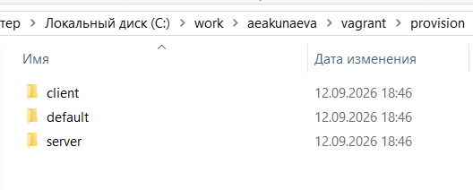
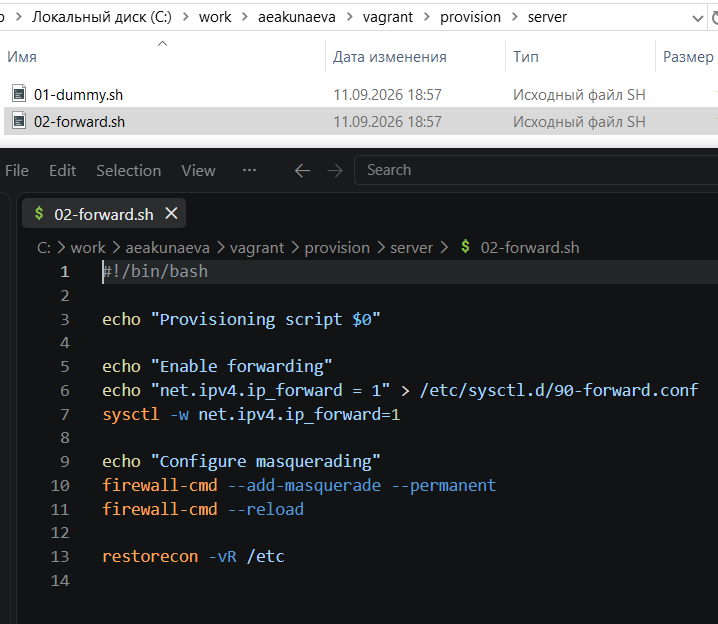
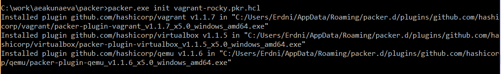
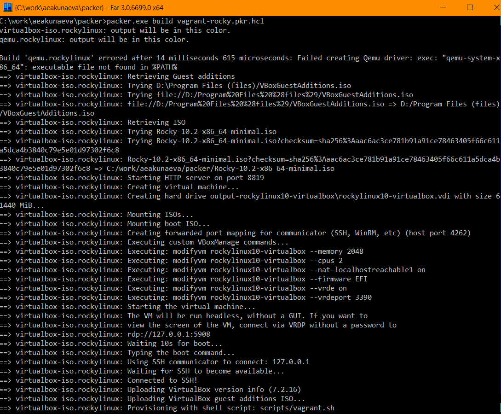
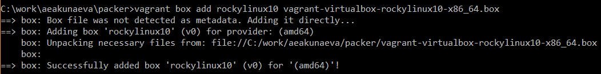
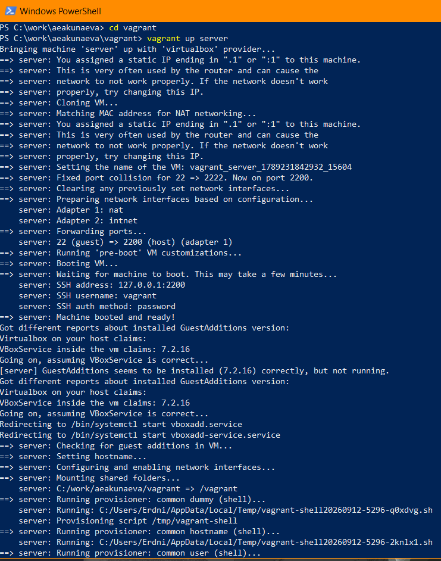
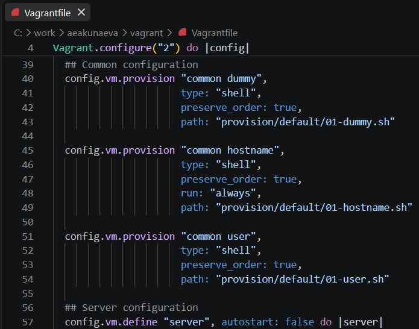
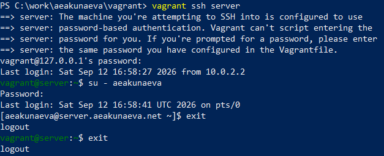

---
## Front matter
lang: ru-RU
title: Лабораторная работа №1
subtitle: Подготовка лабораторного стенда
author:
  - Акунаева Антонина Эрдниевна
institute:
  - Российский университет дружбы народов, Москва, Россия
  
date: 2026-09-12

## i18n babel
babel-lang: russian
babel-otherlangs: english

## Formatting pdf
toc: false
toc-title: Содержание
slide_level: 2
aspectratio: 169
section-titles: true
theme: metropolis
header-includes:
 - \metroset{progressbar=frametitle,sectionpage=progressbar,numbering=fraction}
---

# Информация

## Докладчик

:::::::::::::: {.columns align=center}
::: {.column width="70%"}

  * Акунаева Антонина Эрдниевна
  * студент ФФМиЕН, НПИбд-02-24
  * Российский университет дружбы народов
  * [1032240492@rudn.ru](mailto:1032240492@rudn.ru)
  * <https://github.com/Akuxee>

:::
::: {.column width="30%"}


:::
::::::::::::::

# Цели и задачи

- Целью данной работы является приобретение практических навыков установки Rocky Linux на виртуальную машину с помощью инструмента Vagrant.

1. Сформируйте box-файл с дистрибутивом Rocky Linux для VirtualBox (см. раздел 1.5.2 или 1.5.3).
2. Запустите виртуальные машины сервера и клиента и убедитесь в их работоспособности.
3. Внесите изменения в настройки загрузки образов виртуальных машин server и client, добавив пользователя с правами администратора и изменив названия хостов (см. раздел 1.5.4).
4. Скопируйте необходимые для работы с Vagrant файлы и box-файлы виртуальных машин на внешний носитель. Используя эти файлы, вы можете попробовать развернуть виртуальные машины на другом компьютере.

# Материалы и методы

- Linux (дистрибутив Rocky 10.2)
- Linux Fedora Workstation (Markdown)
- Oracle VirtualBox 7.2.16
- Vagrant 2.4.9 (Windows amd64)
- FAR Manager 3.0 build 6699 x64
- Packer 1.16.0 (Windows amd64)

# Выполнение лабораторной работы

## Создание каталога для проекта

{#fig:001 width=70%}

## Добавление файла vagrant-rocky.pkr.hcl

{#fig:002 width=70%}

## Файл packer/http/rocky10-ks.cfg

{#fig:003 width=70%}

## Файл vagrant/Vagrantfile

{#fig:004 width=70%}

## Подкаталоги vagrant/provision/client default server

{#fig:005 width=70%}

## Файлы подкаталога vagrant/provision/default

{#fig:006 width=70%}

## Файлы подкаталога vagrant/provision/server

{#fig:007 width=70%}

## Файлы подкаталога vagrant/provision/client

{#fig:008 width=70%}

## Установка Rocky Linux при помощи FAR: init

```
packer.exe init vagrant-rocky.pkr.hcl
```

{#fig:009 width=70%}

## Установка Rocky Linux при помощи FAR: build

```
packer.exe build vagrant-rocky.pkr.hcl
```

{#fig:010 width=70%}

## Регистрация образа виртуальной машины

```
vagrant box add rockylinux10 vagrant-virtualbox-rockylinux10-x86_64.box
```

{#fig:011 width=70%}

## Запуск виртуальной машины Server

```
 vagrant up server
```

{#fig:012 width=70%}

## Запуск виртуальной машины Client

```
 vagrant up client
```

{#fig:013 width=70%}

## Подключение к серверу и клиенту из консоли и выход

```
vagrant ssh server/client
su - aeakunaeva
exit
```

{#fig:014 width=70%}

## Проверка файла Vagrantfile

{#fig:015 width=70%}

## Сохранение изменений внутренних настроек ВМ для Server

```
vagrant up server --provision
```

{#fig:016 width=70%}

## Проверка приглашения для Server

{#fig:017 width=70%}

## Сохранение изменений внутренних настроек ВМ для Client

```
vagrant up client --provision
```

{#fig:018 width=70%}


# Выводы

Я приобрела практические навыки установки Rocky Linux на виртуальную машину с помощью инструмента Vagrant.

