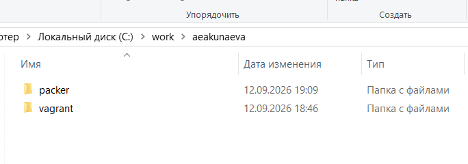
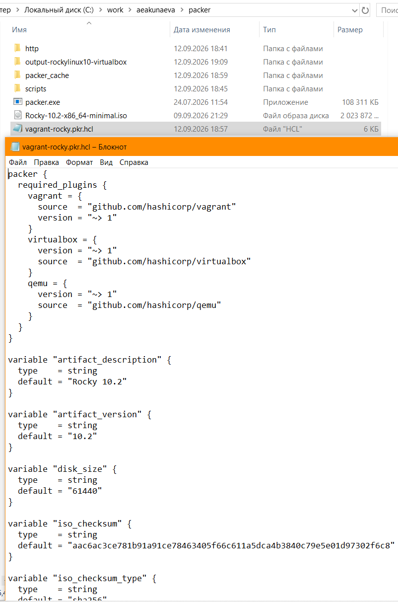
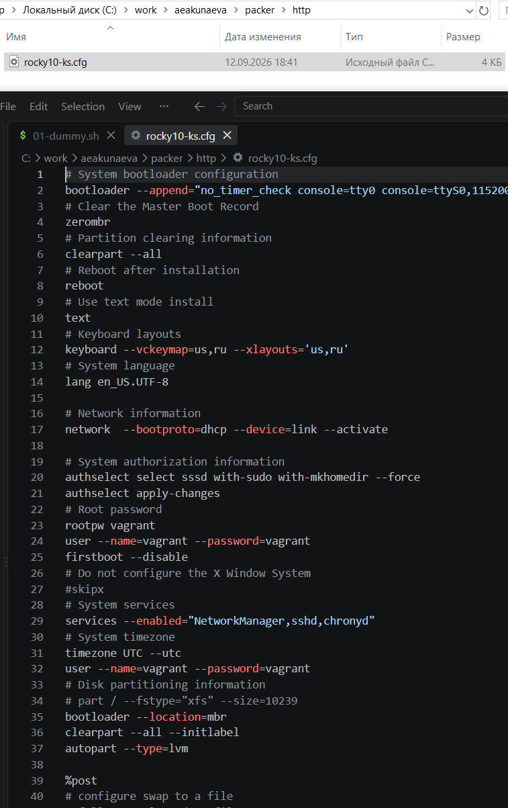
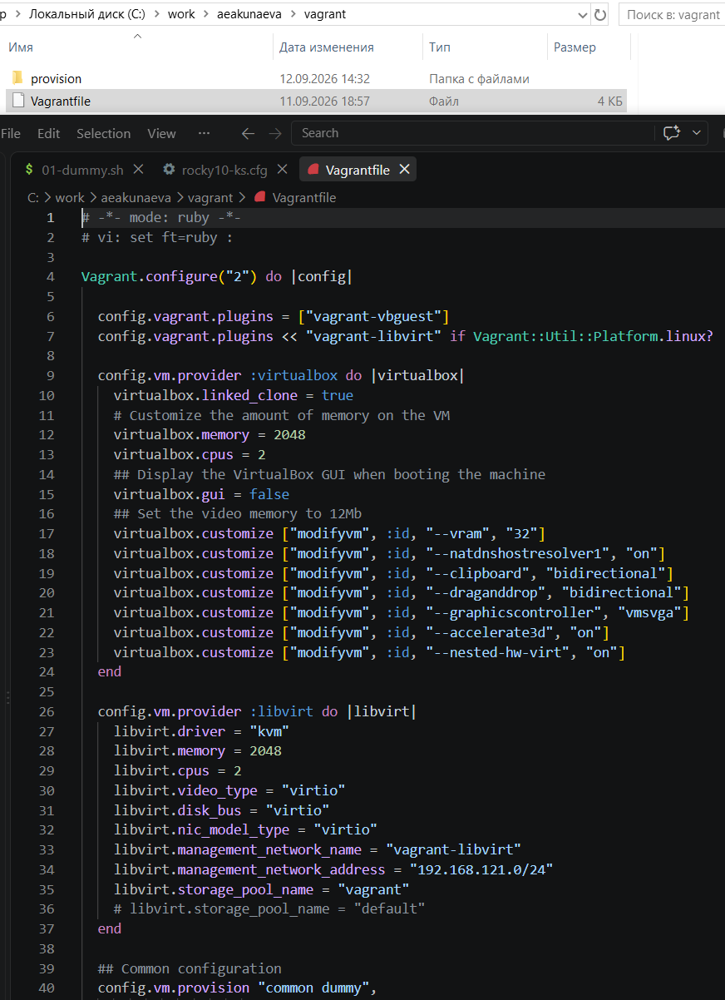
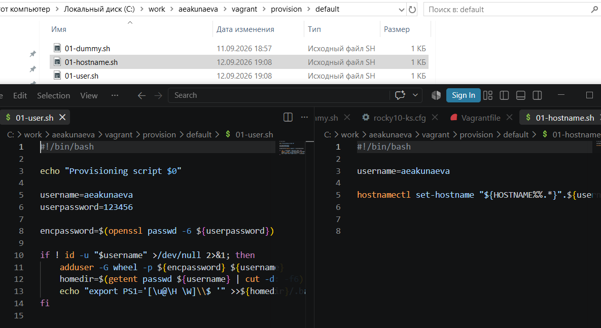
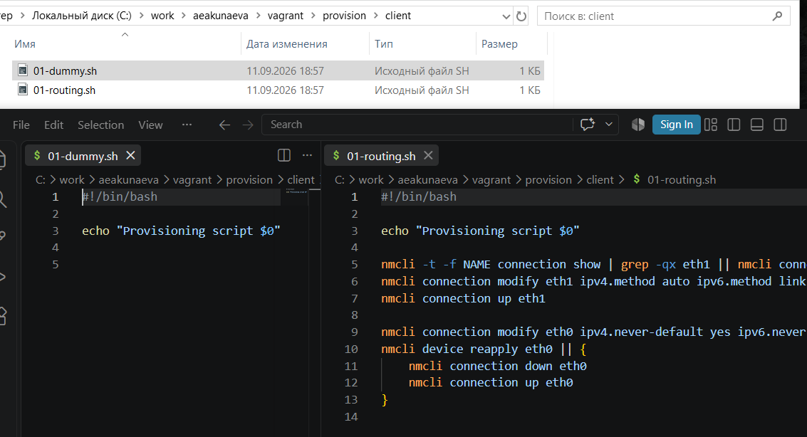
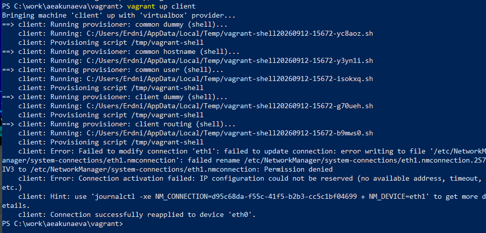
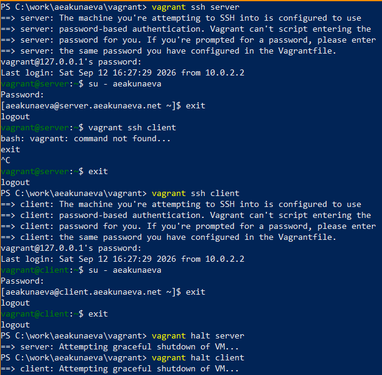
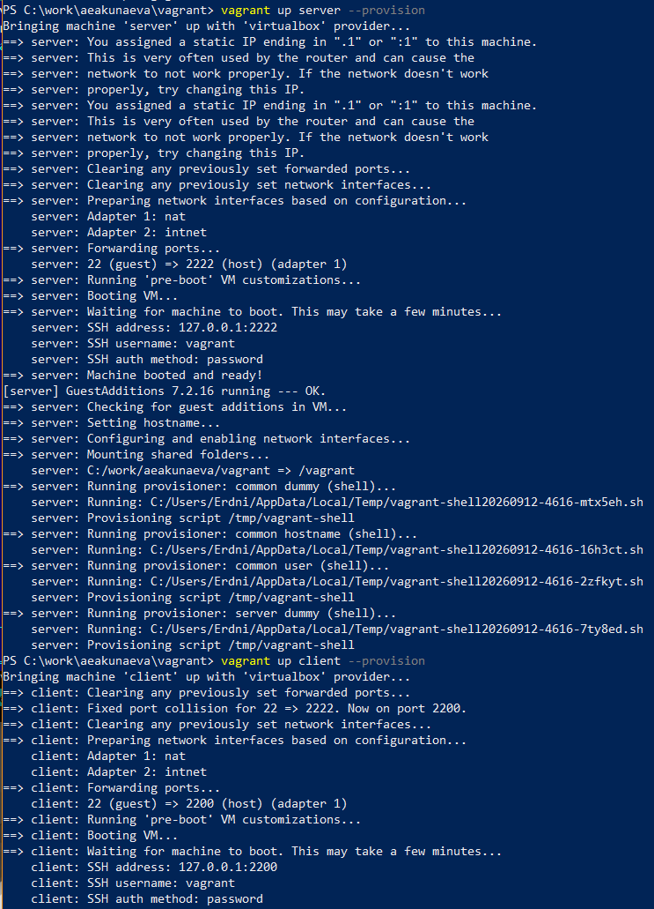
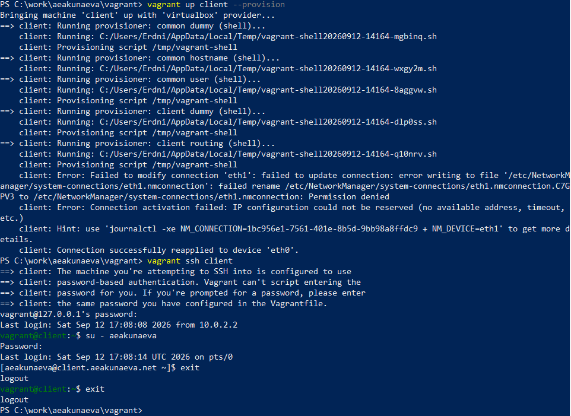

---
## Front matter
title: "Отчёт по лабораторной работе №1"
subtitle: "Подготовка лабораторного стенда"
author: "Акунаева Антонина Эрдниевна"

## Generic otions
lang: ru-RU
toc-title: "Содержание"

## Bibliography
bibliography: bib/cite.bib
csl: pandoc/csl/gost-r-7-0-5-2008-numeric.csl

## Pdf output format
toc: true # Table of contents
toc-depth: 2
lof: true # List of figures
lot: true # List of tables
fontsize: 12pt
linestretch: 1.5
papersize: a4
documentclass: scrreprt
## I18n polyglossia
polyglossia-lang:
  name: russian
  options:
	- spelling=modern
	- babelshorthands=true
polyglossia-otherlangs:
  name: english
## I18n babel
babel-lang: russian
babel-otherlangs: english
## Fonts
mainfont: IBM Plex Serif
romanfont: IBM Plex Serif
sansfont: IBM Plex Sans
monofont: IBM Plex Mono
mathfont: STIX Two Math
mainfontoptions: Ligatures=Common,Ligatures=TeX,Scale=0.94
romanfontoptions: Ligatures=Common,Ligatures=TeX,Scale=0.94
sansfontoptions: Ligatures=Common,Ligatures=TeX,Scale=MatchLowercase,Scale=0.94
monofontoptions: Scale=MatchLowercase,Scale=0.94,FakeStretch=0.9
mathfontoptions:
## Biblatex
biblatex: true
biblio-style: "gost-numeric"
biblatexoptions:
  - parentracker=true
  - backend=biber
  - hyperref=auto
  - language=auto
  - autolang=other*
  - citestyle=gost-numeric
## Pandoc-crossref LaTeX customization
figureTitle: "Рис."
tableTitle: "Таблица"
listingTitle: "Листинг"
lofTitle: "Список иллюстраций"
lotTitle: "Список таблиц"
lolTitle: "Листинги"
## Misc options
indent: true
header-includes:
  - \usepackage{indentfirst}
  - \usepackage{float} # keep figures where there are in the text
  - \floatplacement{figure}{H} # keep figures where there are in the text
---


# Цель работы

Целью данной работы является приобретение практических навыков установки Rocky Linux на виртуальную машину с помощью инструмента Vagrant. [@TUIS-lab]

# Задание

1. Сформируйте box-файл с дистрибутивом Rocky Linux для VirtualBox (см. раздел 1.5.2 или 1.5.3).
2. Запустите виртуальные машины сервера и клиента и убедитесь в их работоспособности.
3. Внесите изменения в настройки загрузки образов виртуальных машин server и client, добавив пользователя с правами администратора и изменив названия хостов (см. раздел 1.5.4).
4. Скопируйте необходимые для работы с Vagrant файлы и box-файлы виртуальных машин на внешний носитель. Используя эти файлы, вы можете попробовать развернуть виртуальные машины на другом компьютере.

# Выполнение лабораторной работы

**Реализация**

Работаем в ОС Windows 10. Создаём каталог проекта C:/work/aeakuneva/packer и C:/work/aeakuneva/vagrant ([рис. @fig:001]):

{#fig:001 width=70%}

В подкаталог packer переносим образ варианта операционной системы Rocky Linux 10.2 Rocky-10.2-x86_64-minimal.iso, также создаём файл vagrant-rocky.pkr.hcl, в который вставляем содержимое из методички (также переносим из примера рабочего каталога с GitHub папку Scripts, не указанную в методичке). Добавим заранее установленный packer.exe в каталог ([рис. @fig:002]):

{#fig:002 width=70%}

Создаём подкаталог *packer/http*, где создаём файл rocky10-ks.cfg и также вставляем в него соответствующее содержимое из методички ([рис. @fig:003]):

{#fig:003 width=70%}

Переходим в каталог *aeakunaeva/vagrant* и создаём файл Vagrantfile, добавляем содержимое. Т.к. работаем в системе Windows, файл Makefile нам не требуется ([рис. @fig:004]):

{#fig:004 width=70%}

В каталоге vagrant создаём подкаталог provision, в котором создаём подкаталоги client, default и server, в которые вставляем по файлу-заглушке 01-dummy.sh с содержимым ([рис. @fig:005]):

```
#!/bin/bash
echo "Provisioning script $0"
```

{#fig:005 width=70%}

В подкаталог default добавляем также файлы 01-hostname.sh и 01-user.sh ([рис. @fig:006]):

*01-user.sh*
```
#!/bin/bash
echo "Provisioning script $0"
username=aeakunaeva
userpassword=123456
encpassword=`openssl passwd -1 ${userpassword}`
id -u $username
if [[ $? ]]
then
adduser -G wheel -p ${encpassword} ${username}
homedir=`getent passwd ${username} | cut -d: -f6`
echo "export PS1='[\u@\H \W]\\$ '" >> ${homedir}/.bashrc
fi
```

*01-hostname.sh*
```
#!/bin/bash
username=aeakunaeva
hostnamectl set-hostname "${HOSTNAME%%.*}".${username}.net
```

{#fig:006 width=70%}

В подкаталог server добавляем файл 02-forward.sh ([рис. @fig:007]):

```
#!/bin/bash
echo "Provisioning script $0"
echo "Enable forwarding"
echo "net.ipv4.ip_forward = 1" > /etc/sysctl.d/90-forward.conf
sysctl -w net.ipv4.ip_forward=1
echo "Configure masquerading"
firewall-cmd --add-masquerade --permanent
firewall-cmd --reload
restorecon -vR /etc
```

{#fig:007 width=70%}

В подкаталог client добавляем файл 01-routing.sh ([рис. @fig:008]):

```
#!/bin/bash
echo "Provisioning script $0"
nmcli connection modify "System eth1" ipv4.gateway "192.168.1.1"
nmcli connection up "System eth1"
nmcli connection modify eth0 ipv4.never-default true
nmcli connection modify eth0 ipv6.never-default true
nmcli connection down eth0
nmcli connection up eth0
```

{#fig:008 width=70%}

**1.5.3. Развёртывание лабораторного стенда на ОС Windows**

Запустим ранее установленный FAR, перейдём в наш рабочий каталог *C:/work/aeakunaeva/packer*, где размещён packer.exe и пропишем в терминале последовательно ([рис. @fig:009]-[рис. @fig:010]):

```
packer.exe init vagrant-rocky.pkr.hcl
packer.exe build vagrant-rocky.pkr.hcl
```

{#fig:009 width=70%}

{#fig:010 width=70%}

В терминале по завершении введём для регистрации образа виртуальной машины ([рис. @fig:011]):

```
vagrant box add rockylinux10 vagrant-virtualbox-rockylinux10-x86_64.box
```

{#fig:011 width=70%}

В Microsoft PowerShell перейдём в наш рабочий каталог и введём для запуска виртуальных машин Server и Client поочерёдно ([рис. @fig:012]-[рис. @fig:013]):
 
 ```
 vagrant up server
 vagrant up client
 ```

{#fig:012 width=70%}

{#fig:013 width=70%}

Подключимся к серверу и к клиенту (последовательно для каждого) из консоли, введя пароль vagrant и перейдя к своему пользователю aeakunaeva (с вводом пароля, указанного ранее в файлах). Затем отлогинимся от обоих ([рис. @fig:014]):

```
vagrant ssh server
su - aeakunaeva
exit
exit
```

```
vagrant ssh client
su - aeakunaeva
exit
exit
```

После чего выключим виртуальные машины:

```
vagrant halt server
vagrant halt client
```

{#fig:014 width=70%}

**1.5.4. Внесение изменений в настройки внутреннего окружения виртуальной машины**

Проверим содержимое файла Vagrantfile (всё корректно), он должен содержать перед конфигурацией сервера ([рис. @fig:015]):

```
# Common configuration
config.vm.provision "common user",
type: "shell",
preserve_order: true,
path: "provision/default/01-user.sh"
config.vm.provision "common hostname",
type: "shell",
preserve_order: true,
run: "always",
path: "provision/default/01-hostname.sh"
```

{#fig:015 width=70%}

Зафиксируем изменения для внутренних настроек виртуальных машин через терминал на ОС Windows ([рис. @fig:016]-[рис. @fig:017]-[рис. @fig:018]):

```
vagrant up server --provision
vagrant up client --provision
```

Для корректной работы залогинимся и убедимся, что приглашения в треминале отображаются как *aeakuneva@client.user.net* и *aeakunaeva@server.user.net*

{#fig:016 width=70%}

{#fig:017 width=70%}

{#fig:018 width=70%}


# Контрольные вопросы

1. **Для чего предназначен Vagrant?**

Vagrant предназначен для создания и управления средами виртуальных машин в одном рабочем пространстве, позволяя автоматизировать процесс установки на виртуальную машину необходимых дистрибутивов ОС и настроек для них.

2. **Что такое box-файл? В чём назначение Vagrantfile?**

- Box-файл, или Vagrant-box - это сохранённый образ виртуальной машины с развёрнутой в ней ОС и настройками для неё, предназначенный для удобного клонирования виртуальных машин.  
- Vagrantfile предназначен для хранения настроек запуска виртуальных машин и является по своей сути конфигурационным файлом Vagrant.

3. **Приведите описание и примеры вызова основных команд Vagrant.**

Некоторые из основных команд Vagrant:

– vagrant help — вызов справки по командам Vagrant;  
– vagrant box list — список подключённых к Vagrant box-файлов;  
– vagrant box add — подключение box-файла к Vagrant;  
– vagrant destroy — отключение box-файла от Vagrant и удаление его из виртуального окружения;  
– vagrant init — создание «шаблонного» конфигурационного файла Vagrantfile для его последующего изменения;  
– vagrant up — запуск виртуальной машины с использованием инструкций по запуску из конфигурационного файла Vagrantfile;  
– vagrant reload — перезагрузка виртуальной машины;  
– vagrant halt — остановка и выключение виртуальной машины;  
– vagrant provision — настройка внутреннего окружения имеющейся виртуальной машины (например, добавление новых инструкций (скриптов) в ранее созданную виртуальную машину);  
– vagrant ssh — подключение к виртуальной машине через ssh.  

На изображении показано действие команд vagrant ssh для подключения к виртуальной машине Server (и Client) и vagrant halt для выключения виртуальных машин ([рис. @fig:019]):

{#fig:019 width=70%}

4. **Дайте построчные пояснения содержания файлов vagrant-rocky.pkr.hcl, ks.cfg, Vagrantfile, Makefile.**


*vagrant-rocky.pkr.hcl*

Шаблон Packer, который собирает образ Rocky Linux из .iso в box-файл.
В packer/required_plugins происходит подключение необходимых плагинов (vagrant, wirtualbox, qemu), затем в variables обозначаются параметры сборки виртуальной машины, а в source qemu сборка образа в QEMU/KVM, в source vurtualbox-iso - сборка в VirutalBox с настройками vboxmanage. В build сборка из обоих источников с учётом настроек provision и создание box-файла.


*rocky10-ks.cfg*

Конфигурационный файл, отвечающий на запросы установщика ВМ с настройками для машины, позволяющий установить её автоматически.
Содержит информацию по сетям, сервисам, пользователям, правам и прочим базовым настройкам виртуальной машины (язык, раскладка, sudo, SSH-ключи, kdump и т.д.).


*Vagrantfile*

Конфигурационный файл Vagrant, описывающий виртуальные машины Server и Client на основе box-файла и их настройки (плагины , провайдер VB, provision).


*Makefile*

Вспомогательный файл для упрощённой сборки box-файла и менеджмента ВМ. Содержит объявленные переменные, список целей (help) и блоки для разных команд-манипуляций над ВМ (check, addbox, status, destroy).

# Выводы

Я приобрела практические навыки установки Rocky Linux на виртуальную машину с помощью инструмента Vagrant.

# Список литературы{.unnumbered} 

::: {#refs}
:::
