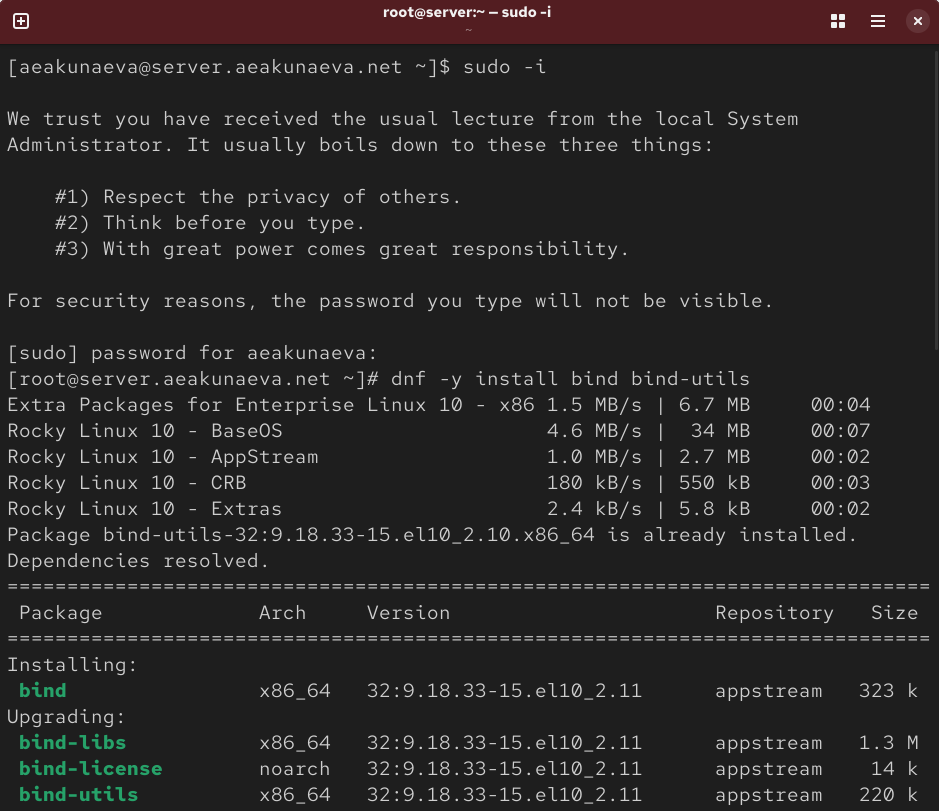
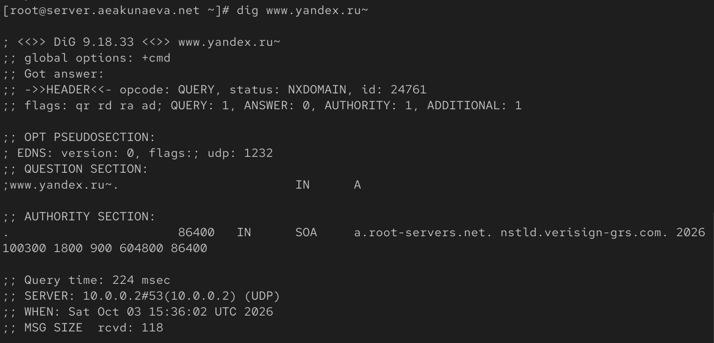
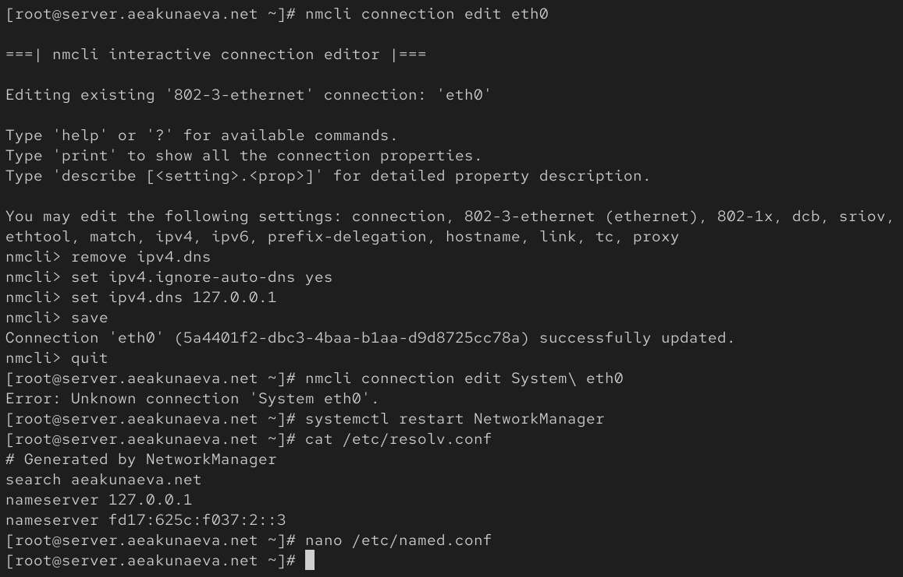
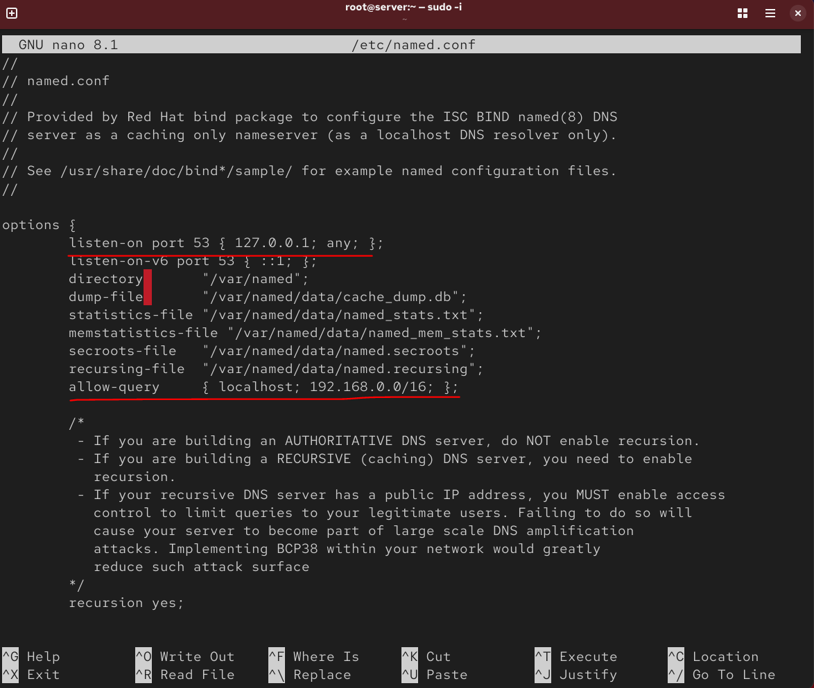
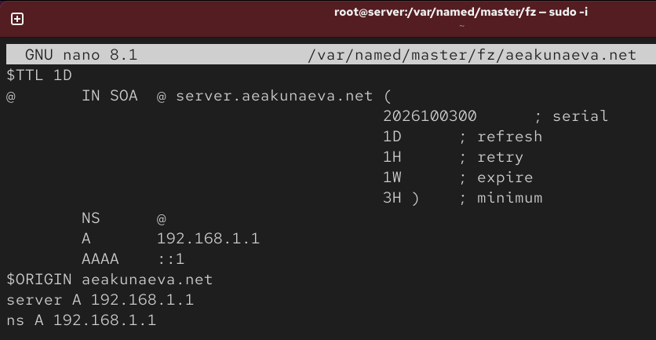
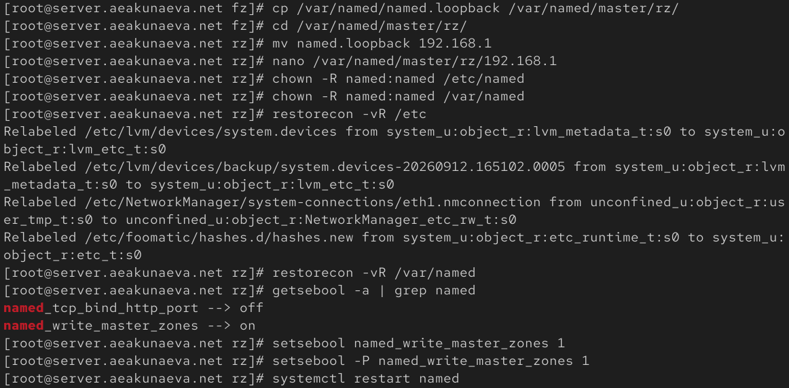
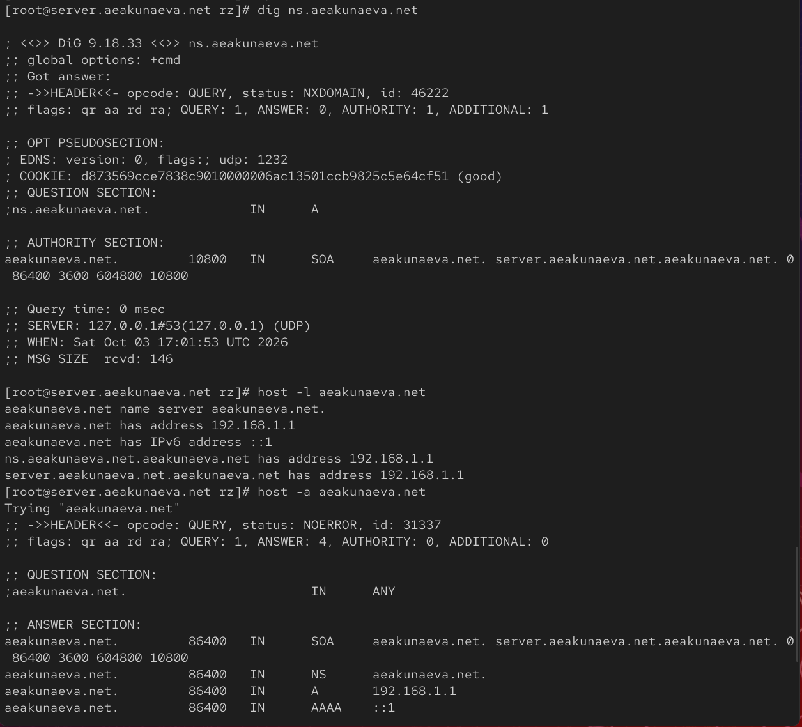
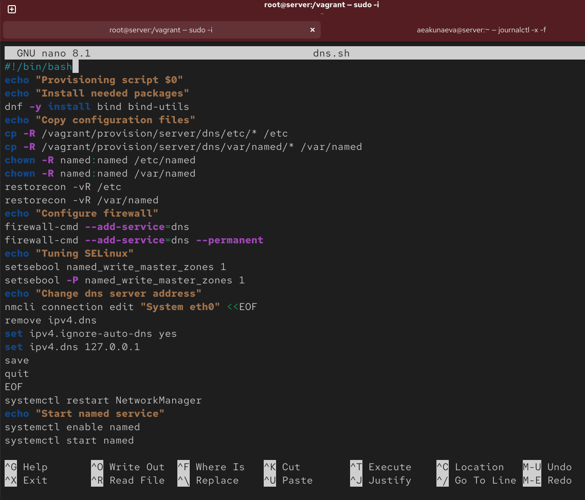

---
## Front matter
lang: ru-RU
title: Лабораторная работа №2
subtitle: Настройка DNS-сервера
author:
  - Акунаева Антонина Эрдниевна
institute:
  - Российский университет дружбы народов, Москва, Россия
  
date: 2026-10-29

## i18n babel
babel-lang: russian
babel-otherlangs: english

## Formatting pdf
toc: false
toc-title: Содержание
slide_level: 2
aspectratio: 169
section-titles: true
theme: metropolis
header-includes:
 - \metroset{progressbar=frametitle,sectionpage=progressbar,numbering=fraction}
---

# Информация

## Докладчик

:::::::::::::: {.columns align=center}
::: {.column width="70%"}

  * Акунаева Антонина Эрдниевна
  * студент ФФМиЕН, НПИбд-02-24
  * Российский университет дружбы народов
  * [1032240492@rudn.ru](mailto:1032240492@rudn.ru)
  * <https://github.com/Akuxee>

:::
::: {.column width="30%"}

:::
::::::::::::::

# Цели и задачи

- Приобретение практических навыков по установке и конфигурированию DNS-сервера, усвоение принципов работы системы доменных имён.  

1. Установите на виртуальной машине server DNS-сервер bind и bind-utils (см. раздел 2.4.1).  

2. Сконфигурируйте на виртуальной машине server кэширующий DNS-сервер (см. раздел 2.4.2).  

3. Сконфигурируйте на виртуальной машине server первичный DNS-сервер (см. раздел 2.4.3).  

4. При помощи утилит dig и host проанализируйте работу DNS-сервера (см. раздел 2.4.4).  

5. Напишите скрипт для Vagrant, фиксирующий действия по установке и конфигурированию DNS-сервера во внутреннем окружении виртуальной машины server. Соответствующим образом внесите изменения в Vagrantfile (см. раздел 2.4.5).  

# Материалы и методы

- Linux (дистрибутив Rocky 10.2)
- Linux Fedora Workstation (Markdown)
- Oracle VirtualBox 7.2.16
- Vagrant 2.4.9 (Windows amd64)
- FAR Manager 3.0 build 6699 x64
- Packer 1.16.0 (Windows amd64)

# Выполнение лабораторной работы

## Запуск виртуальной машины server

{#fig:001 width=70%}

## Установка bind и bind-utils

{#fig:002 width=70%}

## Запрос dig к DNS-адресу

{#fig:003 width=70%}

## Установка DNS-сервера сервером по умолчанию

{#fig:004 width=70%}

## Настройка направления DNS-запросов

{#fig:005 width=70%}

## Разрешение работы с DNS

{#fig:006 width=70%}

## Проверка потока DNS-запросов через узел server

{#fig:007 width=70%}

## Создание шаблонов описания DNS-зон

{#fig:008 width=70%}

## Включение файла описания зоны /etc/named/aeakunaeva.net

{#fig:009 width=70%}

## Замена зон в /etc/named/aeakunaeva.net

{#fig:010 width=70%}

## Редактирование данных прямой зоны

{#fig:011 width=70%}

## Настройка меток DNS-зон и конфигурационных файлов

{#fig:012 width=70%}

## Редактирование данных обратной зоны

{#fig:013 width=70%}

## Расширенный лог системных сообщений

{#fig:014 width=70%}

## Внесение изменений в еастройки внутреннего окружения server

{#fig:015 width=70%}

## Скрипт dns.sh для установки и настройки DNS-сервера

{#fig:016 width=70%}

## Внесение изменений в Vagrantfile

{#fig:017 width=70%}

# Выводы

Я приобрела практические навыки по установке и конфигурированию DNS-сервера, усвоила принципы работы системы доменных имён.

