---
## Front matter
title: "Отчёт по лабораторной работе №2"
subtitle: "Настройка DNS-сервера"
author: "Акунаева Антонина Эрдниевна"

## Generic otions
lang: ru-RU
toc-title: "Содержание"

## Bibliography
bibliography: bib/cite.bib
csl: pandoc/csl/gost-r-7-0-5-2008-numeric.csl

## Pdf output format
toc: true # Table of contents
toc-depth: 2
lof: true # List of figures
lot: true # List of tables
fontsize: 12pt
linestretch: 1.5
papersize: a4
documentclass: scrreprt
## I18n polyglossia
polyglossia-lang:
  name: russian
  options:
	- spelling=modern
	- babelshorthands=true
polyglossia-otherlangs:
  name: english
## I18n babel
babel-lang: russian
babel-otherlangs: english
## Fonts
mainfont: IBM Plex Serif
romanfont: IBM Plex Serif
sansfont: IBM Plex Sans
monofont: IBM Plex Mono
mathfont: STIX Two Math
mainfontoptions: Ligatures=Common,Ligatures=TeX,Scale=0.94
romanfontoptions: Ligatures=Common,Ligatures=TeX,Scale=0.94
sansfontoptions: Ligatures=Common,Ligatures=TeX,Scale=MatchLowercase,Scale=0.94
monofontoptions: Scale=MatchLowercase,Scale=0.94,FakeStretch=0.9
mathfontoptions:
## Biblatex
biblatex: true
biblio-style: "gost-numeric"
biblatexoptions:
  - parentracker=true
  - backend=biber
  - hyperref=auto
  - language=auto
  - autolang=other*
  - citestyle=gost-numeric
## Pandoc-crossref LaTeX customization
figureTitle: "Рис."
tableTitle: "Таблица"
listingTitle: "Листинг"
lofTitle: "Список иллюстраций"
lotTitle: "Список таблиц"
lolTitle: "Листинги"
## Misc options
indent: true
header-includes:
  - \usepackage{indentfirst}
  - \usepackage{float} # keep figures where there are in the text
  - \floatplacement{figure}{H} # keep figures where there are in the text
---


# Цель работы

Приобретение практических навыков по установке и конфигурированию DNS-сервера, усвоение принципов работы системы доменных имён. [@TUIS-lab][@tanenbaum_book_modern-os_ru]

# Задание

1. Установите на виртуальной машине server DNS-сервер bind и bind-utils (см. раздел 2.4.1).  

2. Сконфигурируйте на виртуальной машине server кэширующий DNS-сервер (см. раздел 2.4.2).  

3. Сконфигурируйте на виртуальной машине server первичный DNS-сервер (см. раздел 2.4.3).  

4. При помощи утилит dig и host проанализируйте работу DNS-сервера (см. раздел 2.4.4).  

5. Напишите скрипт для Vagrant, фиксирующий действия по установке и конфигурированию DNS-сервера во внутреннем окружении виртуальной машины server. Соответствующим образом внесите изменения в Vagrantfile (см. раздел 2.4.5).  

# Выполнение лабораторной работы

**2.4.1. Установка DNS-сервера**

На нашей ОС Windows переходим в PowerShell в наш рабочий каталог и запускаем виртуальную машину server ([рис. @fig:001]):

```
cd work/aeakunaeva/vagrant
vagrant up server
```

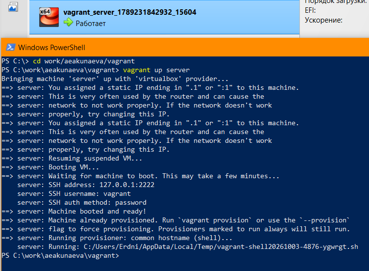{#fig:001 width=70%}

В запустившейся виртуальной машине server переходим под нашим пользователем в терминал как суперпользователь и устанавливаем bind и bin-utils ([рис. @fig:002])[@robbins_book_bash_en]:

```
sudo -i
dnf -y install bind bind-utils
```

{#fig:002 width=70%}

Сделаем тестовый запрос dig к DNS-адресу www.yandex.ru ([рис. @fig:003]):

```
dig www.yandex.ru
```

Секции QUESTION/ANSWER показывают, что запрос ушёл на сервер из /etc/resolv.conf, в ответе - A-записи с IP и TTL, в ;; Query time, ;; SERVER видно, какой сервер отвечал и когда, за какое время ответ пришёл.

{#fig:003 width=70%}

([рис. @fig:004]-[рис. @fig:005]-[рис. @fig:006]-[рис. @fig:007]-[рис. @fig:008])[@zarrelli_book_mastering-bash_en][@newham_book_learning-bash_en]:

1. Файл `/etc/resolv.conf`  
Этот файл используется DNS-клиентом (резолвером) операционной системы для определения, к каким серверам обращаться с запросами.  
 
-   `# Generated by NetworkManager` - комментарий, указывающий, что файл создан автоматически службой NetworkManager (ручное редактирование может быть перезаписано).  
-   `search beelinerouter aeakunaeva.net` - определяет домены поиска. Если при запросе указать только имя хоста (например, `ping server`), система попытается разрешить его как `server.beelinerouter`, затем как `server.aeakunaeva.net`.  
-   `nameserver 10.0.0.2` - первый DNS-сервер для запросов. Вероятно, это DNS-сервер виртуальной сети (шлюз провайдера или гипервизора).  
-   `nameserver 192.168.1.1` - второй DNS-сервер. Это IP-адрес вашего локального сервера (сервера, на котором мы настраиваем BIND).  
-   `nameserver fd17:625c:f037:2::3` - третий DNS-сервер, IPv6-адрес.  
 
----------------------------------------------------------------------
 
2. Файл `/etc/named.conf`  
Основной конфигурационный файл DNS-сервера BIND (демона `named`).  
 
-   `options { ... };` - блок глобальных настроек сервера.  
-   `listen-on port 53 { 127.0.0.1; };` - сервер принимает DNS-запросы только на локальном интерфейсе (localhost) по IPv4.  
-   `listen-on-v6 port 53 { ::1; };` - аналогично для IPv6 (только локально).  
-   `directory "/var/named";` - рабочая директория, в которой по умолчанию ищутся файлы зон, указанные в конфигурации.  
-   `dump-file`, `statistics-file`, `memstatistics-file`, `secroots-file`, `recursing-file` - пути к служебным файлам, куда BIND сохраняет дампы кэша, статистику работы и данные безопасности.  
-   `allow-query { localhost; };` - **важный параметр**. Разрешает выполнение DNS-запросов к этому серверу только с локального хоста. В рамках лабораторной работы этот параметр нужно будет изменить на `{ localhost; 192.168.0.0/16; };`, чтобы клиенты внутренней сети могли обращаться к серверу.  
-   `recursion yes;` - разрешает серверу выполнять рекурсивные запросы (самостоятельно искать ответ во внешней сети, если его нет в кэше).  
-   `dnssec-validation yes;`- включает проверку цифровых подписей DNSSEC для получаемых извне данных (защита от подмены DNS-ответов).  
-   `managed-keys-directory`, `geoip-directory`- служебные директории для ключей DNSSEC и баз GeoIP.
-   `pid-file`, `session-keyfile` - пути к файлам с ID процесса и ключами сессий.  
-   `include "/etc/crypto-policies/back-ends/bind.config";`- подключает системные настройки криптографии (актуально для Fedora/RHEL).  
-   `logging { ... };` - блок настройки логирования. Указывает, что отладочные сообщения пишутся в файл `data/named.run`.  
-   `zone "." IN { type hint; file "named.ca"; };` - определяет корневую зону. Тип `hint` означает, что сервер берет из файла `named.ca` стартовую информацию о корневых серверах Интернета, чтобы знать, куда отправлять запросы.  
-   `include "/etc/named.rfc1912.zones";` - подключает файл с описанием локальных зон (localhost, 127.0.0.0 и т.д.).  
-   `include "/etc/named.root.key";` - подключает ключи для доверия корневой зоне (DNSSEC).  
 
----------------------------------------------------------------------
 
3. Файл `/var/named/named.ca`  
Этот файл содержит подсказки (hints) - список IP-адресов 13 корневых DNS-серверов (от A.ROOT-SERVERS.NET до M.ROOT-SERVERS.NET).  
 
-   Строки, начинающиеся с `;` - это комментарии. Они поясняют, что файл предоставлен InterNIC, и указывают дату последнего обновления (December 20, 2023).  
-   `3600000 NS A.ROOT-SERVERS.NET.` - NS-запись (Name Server). Указывает доменное имя корневого сервера. `3600000`- это TTL (время жизни кэша в секундах).  
-   `A.ROOT-SERVERS.NET. 3600000 A 198.41.0.4` - A-запись (Address). Указывает IPv4-адрес для сервера A.ROOT-SERVERS.NET.  
-   `A.ROOT-SERVERS.NET. 3600000 AAAA 2001:503:ba3e::2:30` - AAAA-запись (IPv6 Address). Указывает IPv6-адрес для этого же сервера.  
-   Далее по аналогии идут записи для серверов B, C, D, E, F, G, H, I, J, K, L и M.  
-   В комментариях (например, `FORMERLY NS.INTERNIC.NET`) указано, каким организациям исторически принадлежали эти серверы.  
 
----------------------------------------------------------------------
 
4. Файл `/var/named/named.localhost`  
Шаблон для файла прямой зоны (используется для локальных зон, например `localhost`). Пример минимально необходимой зоны.  
 
-   `$TTL 1D` — директива, задающая время кэширования по умолчанию (1 Day = 1 сутки).  
-   `@ IN SOA @ rname.invalid. (Запись SOA (Start of Authority). Символ `@` означает текущее имя домена (из директивы $ORIGIN или из имени зоны в named.conf). `rname.invalid.` - почтовый адрес администратора (вместо `@` используется точка).  
    -   `0 ; serial` - серийный номер зоны. В шаблоне стоит 0. При изменениях файла его нужно увеличивать (обычно в формате ГГГГММДДВВ), чтобы slave-серверы поняли, что данные обновились.  
    -   `1D ; refresh` - как часто slave-сервер должен проверять актуальность данных у master-сервера.
    -   `1H ; retry` -через какое время повторять попытку связи, если предыдущая не удалась.  
    -   `1W ; expire` - через какое время (1 неделю) slave-сервер перестанет отвечать на запросы, если так и не смог связаться с master-сервером.  
    -   `3H ) ; minimum` - время кэширования негативных ответов (когда записи не существует).  
-   `NS @` - запись Name Server. Указывает, что сервером для этой зоны является она сама.  
-   `A 127.0.0.1` - A-запись для самого домена (указывает на локальный IP).  
-   `AAAA ::1` - AAAA-запись для самого домена (указывает на локальный IPv6).  
 
----------------------------------------------------------------------
 
5. Файл `/var/named/named.loopback`  
Шаблон для файла обратной зоны (используется для сопоставления IP-адресов обратно в доменные имена).  
 
-   `$TTL 1D` - время кэширования по умолчанию (1 сутки).  
-   Блок `@ IN SOA ...` - идентичен файлу `named.localhost` (определяет авторитативность зоны).  
-   `NS @` - сервер имен для этой зоны — локальный.  
-   `A 127.0.0.1` - A-запись для имени самой зоны.  
-   `AAAA ::1` - AAAA-запись для имени самой зоны.  
-   `PTR localhost.` - *ключевая запись для обратной зоны*. PTR (Pointer) связывает IP-адрес с доменным именем. В данном случае она указывает, что адрес (в контексте этой зоны это 127.0.0.1) соответствует имени `localhost.`.  

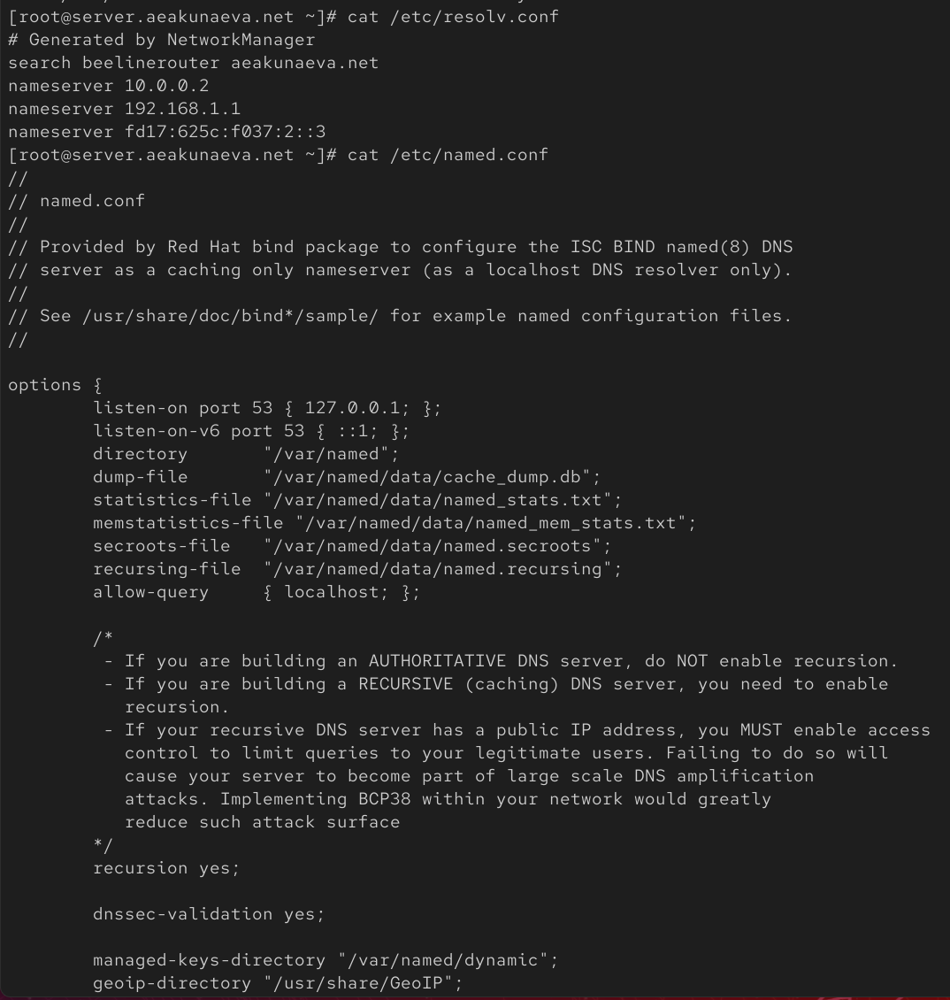{#fig:004 width=70%}

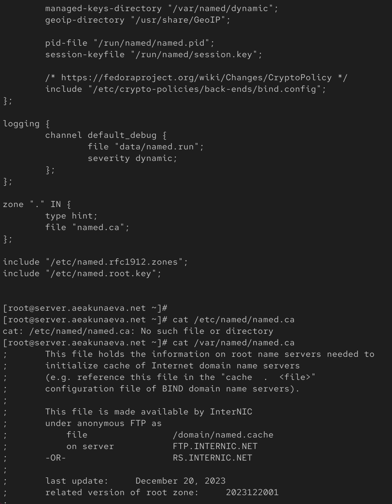{#fig:005 width=70%}

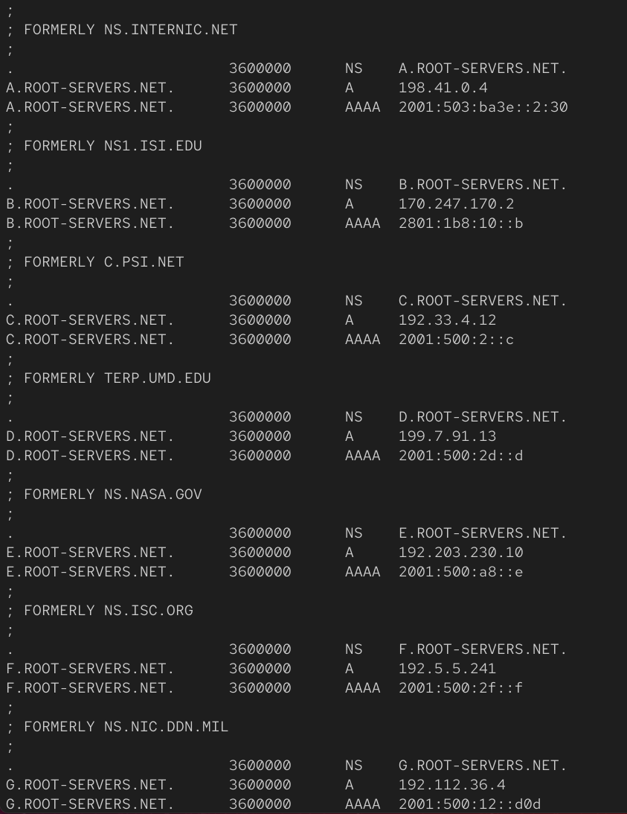{#fig:006 width=70%}

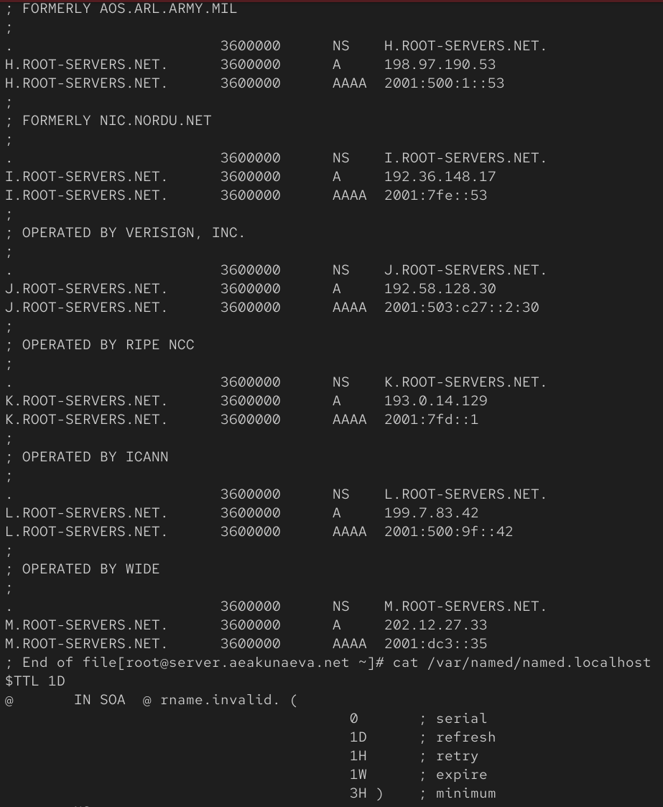{#fig:007 width=70%}

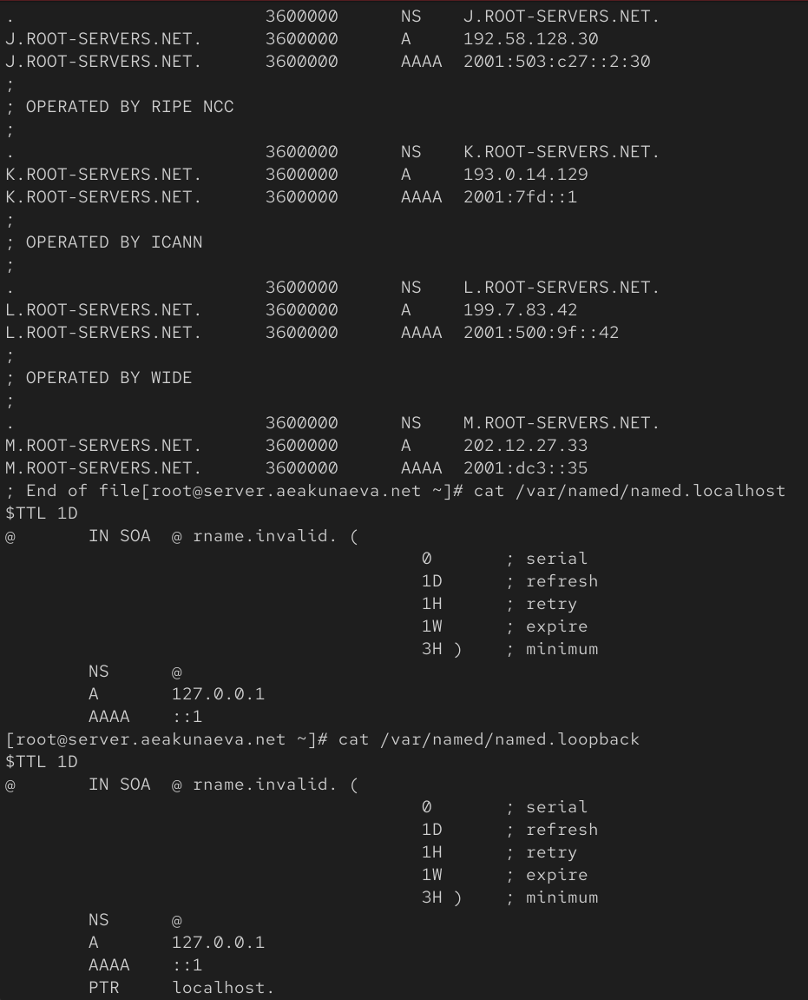{#fig:008 width=70%}

Запустим DNS-сервер и включим его автозапуск при загрузке системы ([рис. @fig:009]):

```
systemctl start named
systemctl enable named
```

Выполним команды 

```
dig www.yandex.ru
```

и

```
dig @127.0.0.1 www.yandex.ru
```

Разница dig www.yandex.ru и dig @127.0.0.1 www.yandex.ru в том, что в первом случае отвечает внешний DNS из resolv.conf, во втором - локальный named (сначала кэш/рекурсия). Если локальный кэширующий сервер не настроен на рекурсию - получите отказ или пустой ответ.

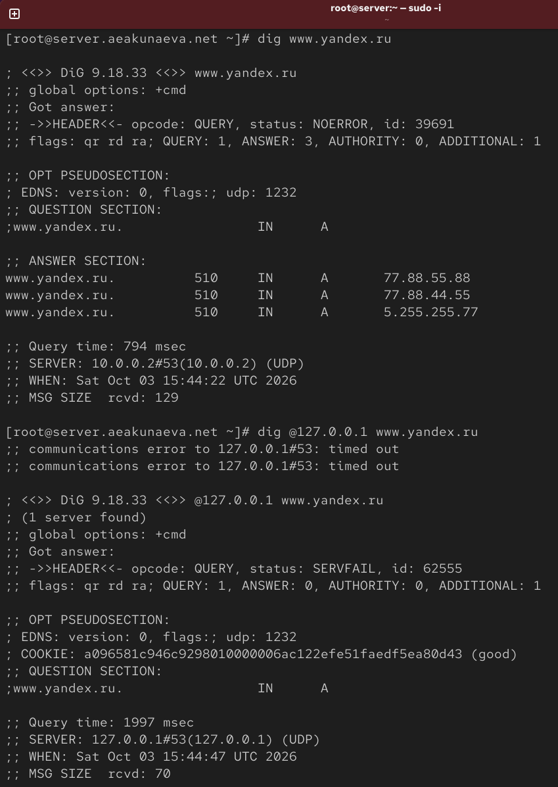{#fig:009 width=70%}

Сделаем DNS-сервер сервером по умолчанию для нашего хоста server и внутренней виртуальной сети, изменив настройки сетевого соединения eth0 в NetworkManager переключением его на работу с внутренней сетью и указанием для него в качестве DNS-сервера по умолчанию адрес 127.0.0.1 ([рис. @fig:010]):

```
nmcli connection edit eth0
remove ipv4.dns
set ipv4.ignore-auto-dns yes
set ipv4.dns 127.0.0.1
save
quit
```

Повторим то же для соединения System eth0, но столкнёмся с тем, что оно не активно (Error: Unknown connection 'System eth0'), потому пропускаем шаг.  

Перезапускаем NetworkManager:

```
systemctl restart NetworkManager
```

И проверяем изменения в конфигурационном файле /etc/resolv.conf: вывод показывает, что адрес изменился на (nameserver) 127.0.0.1, и система использует в качестве DNS-сервера по умолчанию саму себя (localhost), внешний адрес пропал, т.к. мы изменили настройки, как и требовалось:

```
cat /etc/resolv.conf
```

{#fig:010 width=70%}

Откроем конфигурационный файл /etc/named.conf и настроим направление DNS-запросов от всех узлов внутренней сети через узел server, заменив соответствующие строки на ([рис. @fig:011]):

```
listen-on port 53 { 127.0.0.1; any; };
```

```
allow-query { localhost; 192.168.0.0/16; };
```

{#fig:011 width=70%}

Внесём изменения в настройки межсетевого экрана узла server, разрешив работу с DNS, и убедимся, что запросы идут через наш узел, который прослушшивает порт 53 (т.к. по протоколу UDP имеется localhost:domain = порт 53) ([рис. @fig:012]-([рис. @fig:013])):
 
```
firewall-cmd --add-service=dns
firewall-cmd --add-service=dns --permanent
lsof | grep UDP
```

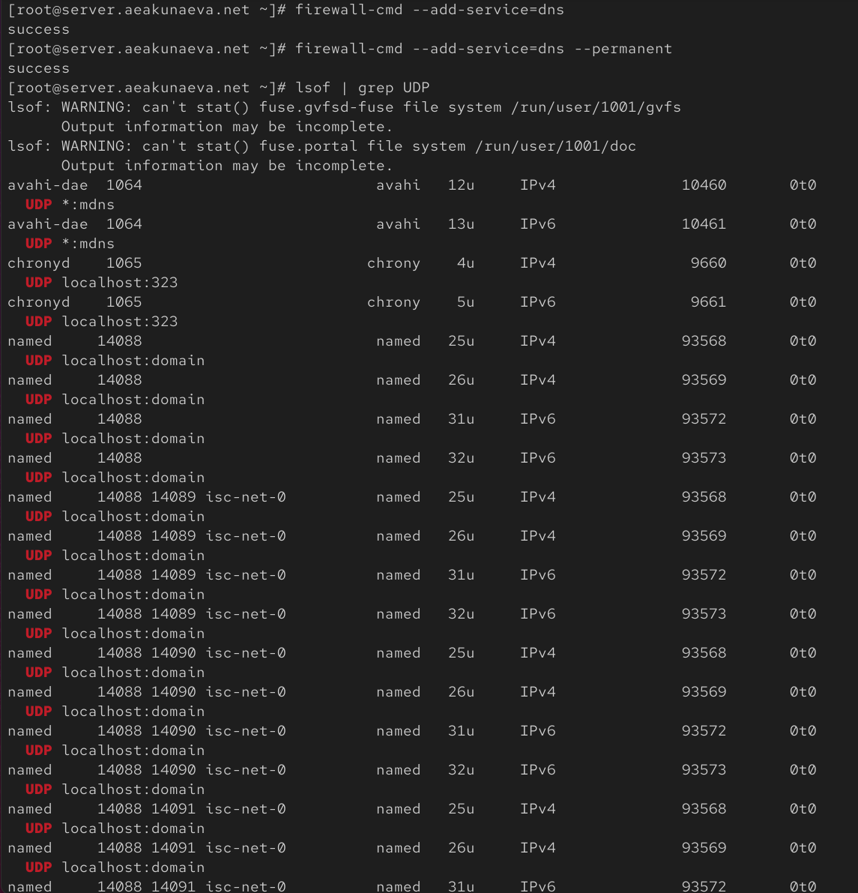{#fig:012 width=70%}

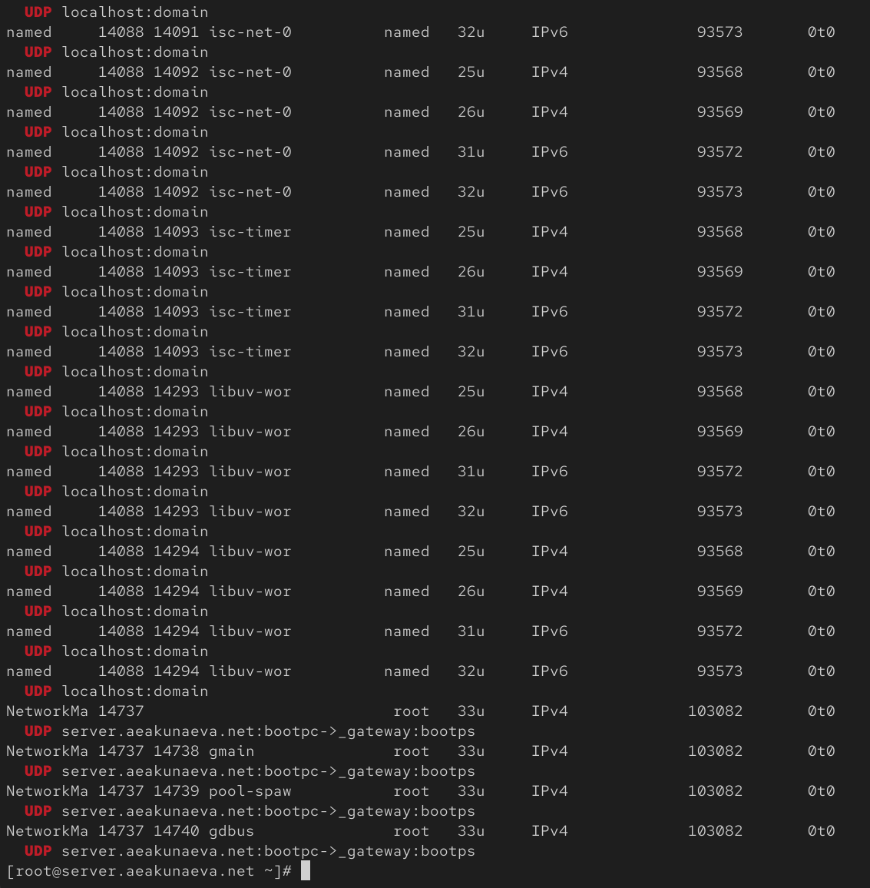{#fig:013 width=70%}

**2.4.3. Конфигурирование первичного DNS-сервера**

Скопируем шаблон описания DNS-зон named.rfc1912.zones из каталога /etc в каталог /etc/named и переименуем его в aeakunaeva.net. Проверим наличие файла через ls ([рис. @fig:014]):

```
cp /etc/named.rfc1912.zones /etc/named/
cd /etc/named
mv /etc/named/named.rfc1912.zones /etc/named/user.net
```

```
ls
```

Далее вносим изменения в конфигурационные файлы (на следующих рис.) через nano и по завершении в каталоге /var/named создадим подкаталоги master/fz и master/rz, в которых будут файлы прямой и обратной зон:

```
cd /var/named
mkdir -p /var/named/master/fz
mkdir -p /var/named/master/rz
```

Скопируем шаблон прямой DNS-зоны named.localhost из каталога /var/named в каталог /var/named/master/fz и переименуем его в aeakunaeva.net:

```
cp /var/named/named.localhost /var/named/master/fz/
cd /var/named/master/fz/
mv named.localhost aeakunaeva.net
```

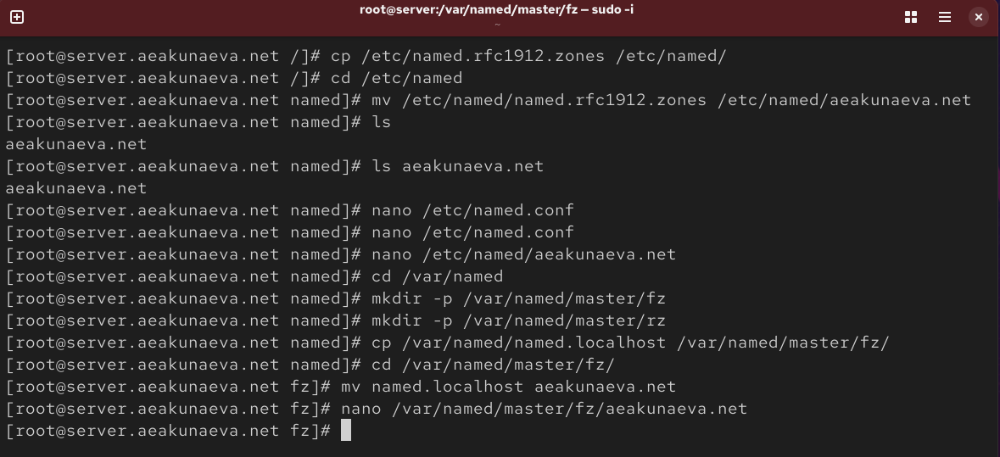{#fig:014 width=70%}

В файле /etc/named.conf добавим в конец строку, чтобы включить файл описания зоны /etc/named/aeakunaeva.net ([рис. @fig:015]):

```
include "/etc/named/aeakunaeva.net";
```

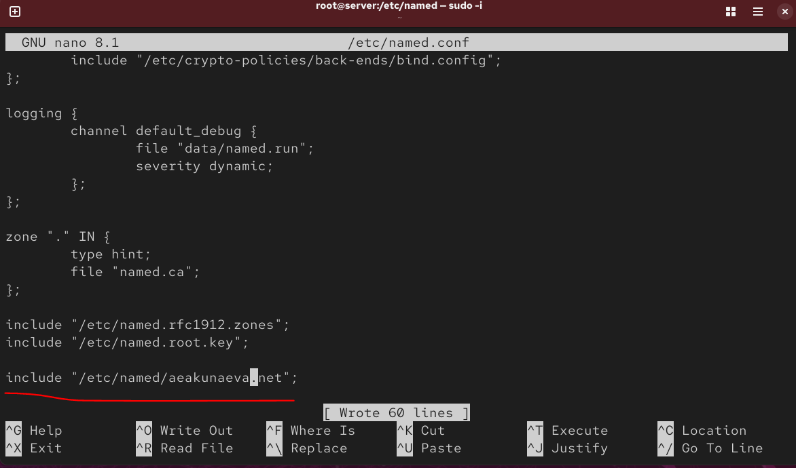{#fig:015 width=70%}

В файле /etc/named/aeakunaeva.net заменим прямую и обратную зоны. Остальные записи удаляем ([рис. @fig:016]):

```
zone "aeakunaeva.net" IN {
type master;
file "master/fz/aeakunaeva.net";
allow-update { none; };
};
```

```
zone "1.168.192.in-addr.arpa" IN {
type master;
file "master/rz/192.168.1";
allow-update { none; };
};
```

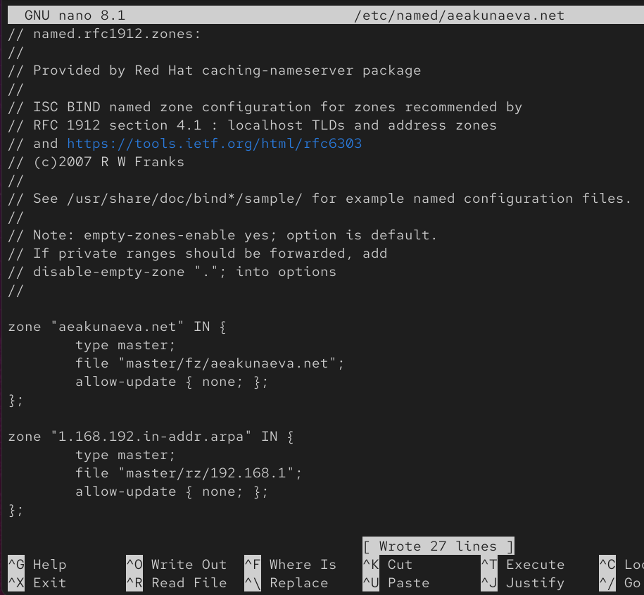{#fig:016 width=70%}

Изменим файл /var/named/master/fz/aeakunaeva.net, указав необходимые DNS-записи для прямой зоны ([рис. @fig:017]):

```
$TTL 1D
@ IN SOA @ server.aeakunaeva.net. (
2024072700 ; serial
1D ; refresh
1H ; retry
1W ; expire
3H ) ; minimum
NS @
A 192.168.1.1
$ORIGIN aeakunaeva.net.
server A 192.168.1.1
ns A 192.168.1.1
```

{#fig:017 width=70%}

Скопируем шаблон обратной DNS-зоны named.loopback из каталога /var/named в каталог /var/named/master/rz и переименуем его в 192.168.1 ([рис. @fig:018]):

```
cp /var/named/named.loopback /var/named/master/rz/
cd /var/named/master/rz/
mv named.loopback 192.168.1
```

Изменим файл /var/named/master/rz/192.168.1 (далее).  

Далее исправляем права доступа к файлам в каталогах /etc/named и /var/named, чтобы демон named мог с ними работать:

```
chown -R named:named /etc/named
chown -R named:named /var/named
```

Восстановить метки конфигурационных файлов named в SELinux:

```
restorecon -vR /etc
restorecon -vR /var/named
```

Для проверки состояния переключателей SELinux, относящихся к named, введём:

```
getsebool -a | grep named
```

Дадим named разрешение на запись в файлы DNS-зоны:

```
setsebool named_write_master_zones 1
setsebool -P named_write_master_zones 1
```
После открытия во втором терминале лога системных сообщений (далее), перезапустим DNS-сервер:

```
systemctl restart named
```

{#fig:018 width=70%}

В файле /var/named/master/fz/aeakunaeva.net укажем необходимые DNS-записи для обратной зоны ([рис. @fig:019]):
 
```
$TTL 1D
@ IN SOA @ server.aeakunaeva.net. (
2026100300 ; serial
1D ; refresh
1H ; retry
1W ; expire
3H ) ; minimum
NS @
A 192.168.1.1
PTR server.aeakunaeva.net.
$ORIGIN 1.168.192.in-addr.arpa.
1 PTR server.aeakunaeva.net.
1 PTR ns.aeakunaeva.net.
```

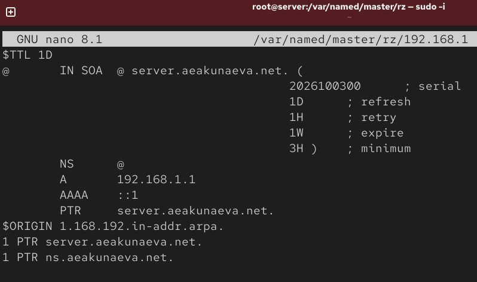{#fig:019 width=70%}

В дополнительном терминале запустим в режиме реального времени расширенный лог системных сообщений, чтобы проверить корректность работы системы ([рис. @fig:020]):

```
journalctl -x -f
```

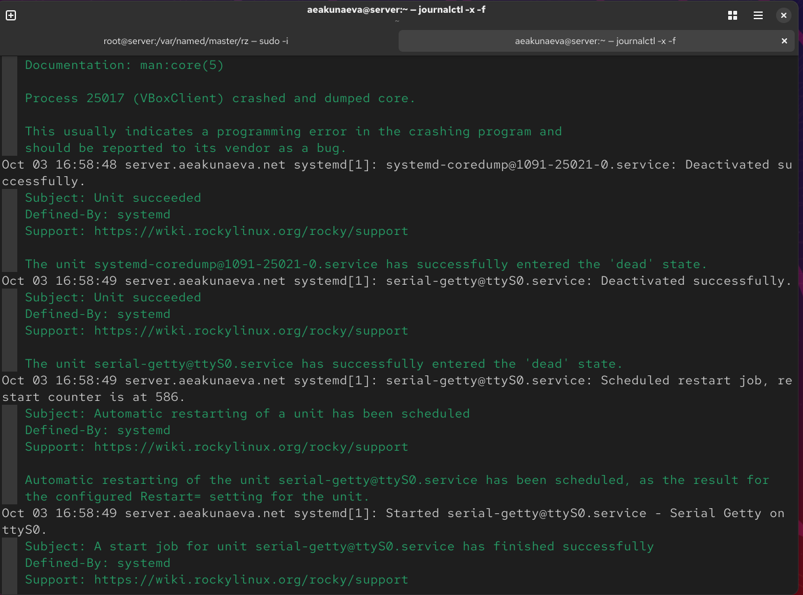{#fig:020 width=70%}

**2.4.4. Анализ работы DNS-сервера**

При помощи утилиты dig получите описание DNS-зоны с сервера ns.aeakunaeva.net ([рис. @fig:021]-([рис. @fig:022])):

```
dig ns.aeakunaeva.net
```

- Секция HEADER: получен ответ со статусом NOERROR, что означает успешную обработку запроса.  

- Секция ANSWER: содержит A-запись, подтверждающую, что хосту ns.aeakunaeva.net соответствует IP-адрес 192.168.1.1.  

- Секция AUTHORITY: содержит SOA-запись, указывающую, что данный сервер является авторитативным (мастер-сервером) для зоны aeakunaeva.net.  

- Секция SERVER: запрос был обработан локальным DNS-сервером по адресу 127.0.0.1 через порт 53.  

При помощи host проанализируем корректность работы DNS-сервера:

```
host -l aeakunaeva.net
host -a aeakunaeva.net
host -t A aeakunaeva.net
host -t PTR 192.168.1.1
```

- *host -l aeakunaeva.net*: выводит полный список всех записей в прямой зоне (NS, A, PTR). Подтверждает корректное разрешение имен server и ns на IP 192.168.1.1 без дублирования доменного имени.

- *host -a aeakunaeva.net*: запрашивает все доступные типы записей (ANY). Вывод подтверждает наличие SOA, NS и A-записей, что свидетельствует о корректном заполнении файла зоны.

- *host -t A aeakunaeva.net*: запрашивает только A-записи. Вывод показывает, что доменное имя aeakunaeva.net успешно резолвится в 192.168.1.1.

- *host -t PTR 192.168.1.1*: проверяет обратную зону. Вывод показывает, что IP-адресу 192.168.1.1 соответствуют имена server.aeakunaeva.net и ns.aeakunaeva.net, что подтверждает корректную настройку обратной зоны в домене in-addr.arpa.

{#fig:021 width=70%}

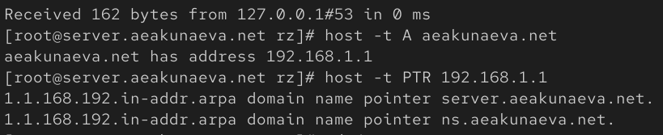{#fig:022 width=70%}

**2.4.5. Внесение изменений в настройки внутреннего окружения виртуальной машины**

Перейдём в каталог для внесения изменений в настройки внутреннего окружения /vagrant/provision/server/, создаём в нём каталог dns, в который поместим в соответствующие каталоги конфигурационные файлы DNS ([рис. @fig:023]):

```
cd /vagrant
mkdir -p /vagrant/provision/server/dns/etc/named
mkdir -p /vagrant/provision/server/dns/var/named/master/
cp -R /etc/named.conf /vagrant/provision/server/dns/etc/
cp -R /etc/named/* /vagrant/provision/server/dns/etc/named/
cp -R /var/named/master/ /vagrant/provision/server/dns/var/named/master/
```

В каталоге /vagrant/provision/server создаём исполняемый файл dns.sh:

```
touch dns.sh
chmod +x dns.sh
```

Откроем на редактирование dns.sh.

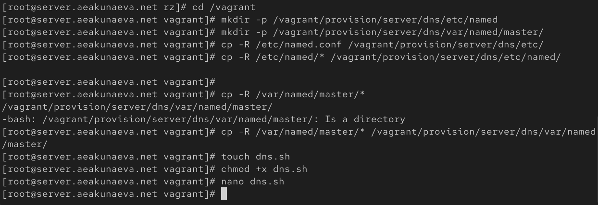{#fig:023 width=70%}

В dns.sh пропишем скрипт для того, чтобы он повторял наши действия по установке и настройки DNS-сервера ([рис. @fig:024]):

{#fig:024 width=70%}

Для отработки созданного скрипта во время загрузки виртуальной машины server в конфигурационном файле Vagrantfile добавим в разделе конфигурации для сервера (в данном случае в Windows) ([рис. @fig:025]):

```
server.vm.provision "server dns",
type: "shell",
preserve_order: true,
path: "provision/server/dns.sh"
```

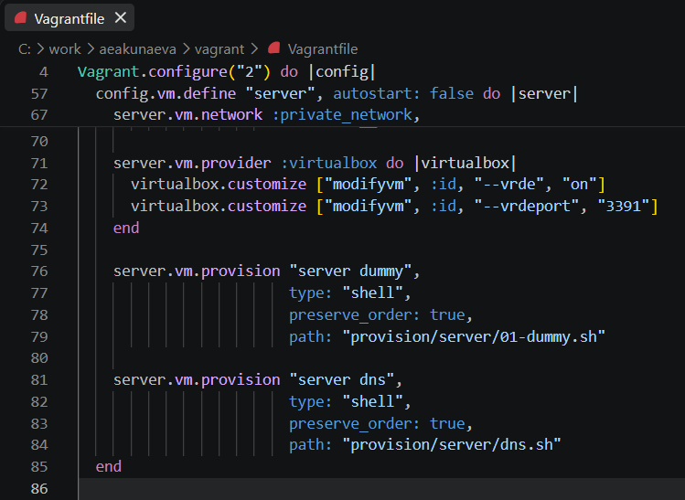{#fig:025 width=70%}


# Контрольные вопросы

1. **Что такое DNS?**  

DNS/Domain Name System - распределённая иерархическая база данных, ставящая в соответствие доменному имени хоста его IP-адрес и наоборот. Работает по модели «клиент-сервер»: DNS-клиент формирует запрос, DNS-сервер отвечает.  

2. **Каково назначение кэширующего DNS-сервера?**  

Кэширующий сервер принимает рекурсивные запросы от клиентов, сам выполняет нерекурсивные запросы к авторитативным серверам и сохраняет (кэширует) полученные ответы, чтобы ускорить последующие обращения и снизить нагрузку на внешние серверы.  

3. **Чем отличается прямая DNS-зона от обратной?**  

Прямая зона хранит записи A (имя -> IP). Обратная зона хранит записи PTR (IP -> имя) и размещается в специальном домене in-addr.arpa (для IPv4), где октеты IP записываются в обратном порядке.  

4. **В каких каталогах и файлах располагаются настройки DNS-сервера? Кратко охарактеризуйте, за что они отвечают.**  

- /etc/named.conf — основной конфигурационный файл (listen-on, allow-query, forwarders, dnssec, include зон);  
- /etc/named/ — подключаемые файлы описания зон (например, /etc/named/user.net);  
- /var/named/ — файлы данных зон: /var/named/master/fz/user.net (прямая), /var/named/master/rz/192.168.1 (обратная), а также named.ca, named.localhost, named.loopback.  

5. **Что указывается в файле resolv.conf?**  

Адреса DNS-серверов (nameserver), домен поиска (search/domain) и опции резолвера. Настройки могут управляться NetworkManager.  

6. **Какие типы записи описания ресурсов есть в DNS и для чего они используются?**  

- SOA — авторитативность для зоны, параметры обновления;  
- NS — DNS-серверы зоны;  
- A — имя -> IPv4;  
- PTR — IP -> имя;  
- CNAME — каноническое имя (псевдоним);  
- MX — почтовые серверы (с приоритетом).  

7. **Для чего используется домен in-addr.arpa?**  

Для обратного разрешения адресов (PTR): IP-адрес преобразуется в имя. Октеты адреса в имени записываются в обратном порядке.   

8. **Для чего нужен демон named?**  

Это сам DNS-сервер BIND: он читает конфигурацию и файлы зон, слушает порт 53 (UDP/TCP), отвечает на запросы, выполняет рекурсию/кэширование и обслуживает авторитативные зоны.  

9. **В чём заключаются основные функции slave-сервера и master-сервера?**  

Master (primary) - хранит эталонные данные зоны в файлах и является источником истины. Slave (secondary) - получает копию зоны от master, периодически проверяет её актуальность по serial (refresh/retry/expire) и обслуживает запросы при недоступности master.  

10. **Какие параметры отвечают за время обновления зоны?**  

В SOA: serial (номер ревизии), refresh (интервал проверки у master), retry (интервал повтора при неудаче), expire (время, после которого slave перестаёт обслуживать зону), minimum (время негативного кэширования). Также директива $TTL.  

11. **Как обеспечить защиту зоны от скачивания и просмотра?**  

Ограничить передачу зоны: allow-transfer {none;} (или только на slave-серверы), allow-query - только доверенным сетям, allow-update { none;} (или только по TSIG-ключу), использовать ACL и TSIG.

12. **Какая запись RR применяется при создании почтовых серверов?**  

MX-запись ([name] [ttl] IN MX [preference] [host]), указывающая почтовый сервер и его приоритет.  

13. **Как протестировать работу сервера доменных имён?**  

Утилитами dig (dig @server domain [type]), host (host -l, host -a, host -t A/PTR), nslookup; проверить named-checkconf и named-checkzone.  

14. **Как запустить, перезапустить или остановить какую-либо службу в системе?**  

systemctl start|restart|stop|status <service>, включение в автозапуск — systemctl enable <service>.  

15. **Как посмотреть отладочную информацию при запуске какого-либо сервиса или службы?**  

journalctl -x -f (в реальном времени), journalctl -u named, systemctl status named, а также логи в /var/log/messages.  

16. **Где храниться отладочная информация по работе системы и служб? Как её посмотреть?**  

В systemd-journald (journalctl), в /var/log/messages, /var/log/secure, а также собственные логи служб. Просмотр: journalctl, journalctl -xe, tail -f /var/log/messages.  

17. **Как посмотреть, какие файлы использует в своей работе тот или иной процесс? Приведите несколько примеров.**  

```
lsof -p <PID>, lsof | grep <name>, ls -l /proc/<PID>/fd, fuser.
```

18. **Приведите несколько примеров по изменению сетевого соединения при помощи командного интерфейса nmcli.**  

```
nmcli connection show
nmcli connection modify eth0 ipv4.dns 127.0.0.1
nmcli connection modify eth0 ipv4.ignore-auto-dns yes
nmcli connection up eth0
nmcli connection edit eth0 → remove ipv4.dns / set ipv4.dns 127.0.0.1 / save / quit
```

19. **Что такое SELinux?**  

Security-Enhanced Linux - механизм мандатного управления доступом в ядре Linux, реализующий политики безопасности (процессы и файлы имеют метки безопасности/контексты).  

20. **Что такое контекст (метка) SELinux?**  

Специальная метка безопасности, присваиваемая процессам и файлам; на её основе принимаются решения о доступе.  

21. **Как восстановить контекст SELinux после внесения изменений в конфигурационные файлы?**  

restorecon -vR /etc, restorecon -vR /var/named - восстанавливает метки по умолчанию согласно политике.  

22. **Как создать разрешающие правила политики SELinux из файлов журналов, содержащих сообщения о запрете операций?**  

audit2allow -a / audit2allow -M mymodule < /var/log/audit/audit.log, затем semodule -i mymodule.pp.  

23. **Что такое булевый переключатель в SELinux?**  

Логический параметр политики (boolean), включающий/выключающий определённое разрешение без перекомпиляции политики (например, named_write_master_zones).  

24. **Как посмотреть список переключателей SELinux и их состояние?**  

```
getsebool -a, getsebool -a | grep named, semanage boolean -l
```

25. **Как изменить значение переключателя SELinux?**  

setsebool named_write_master_zones 1 (до перезагрузки), setsebool -P named_write_master_zones 1 (постоянно).  


# Выводы

Я приобрела практические навыки по установке и конфигурированию DNS-сервера, усвоила принципы работы системы доменных имён.

# Список литературы{.unnumbered} 

::: {#refs}
:::
