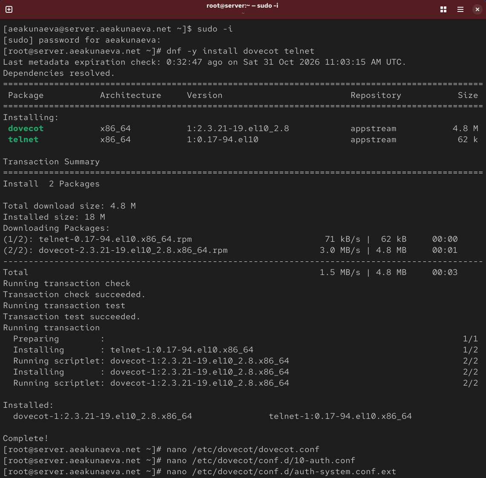
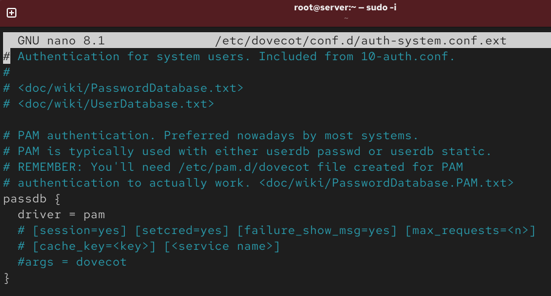
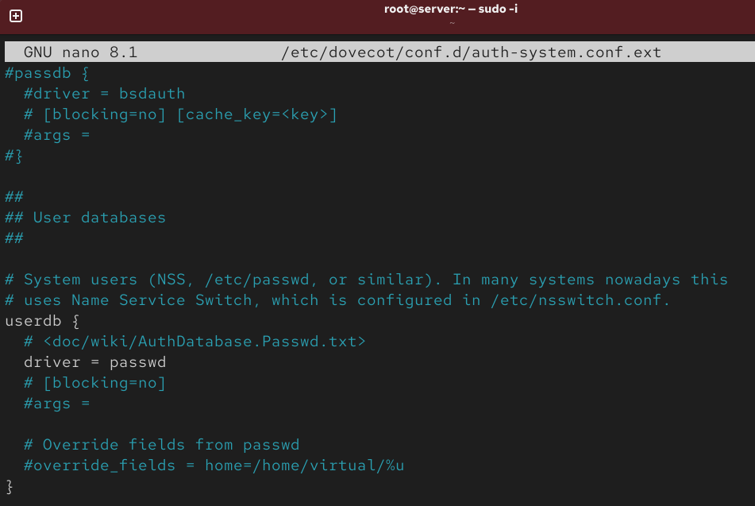
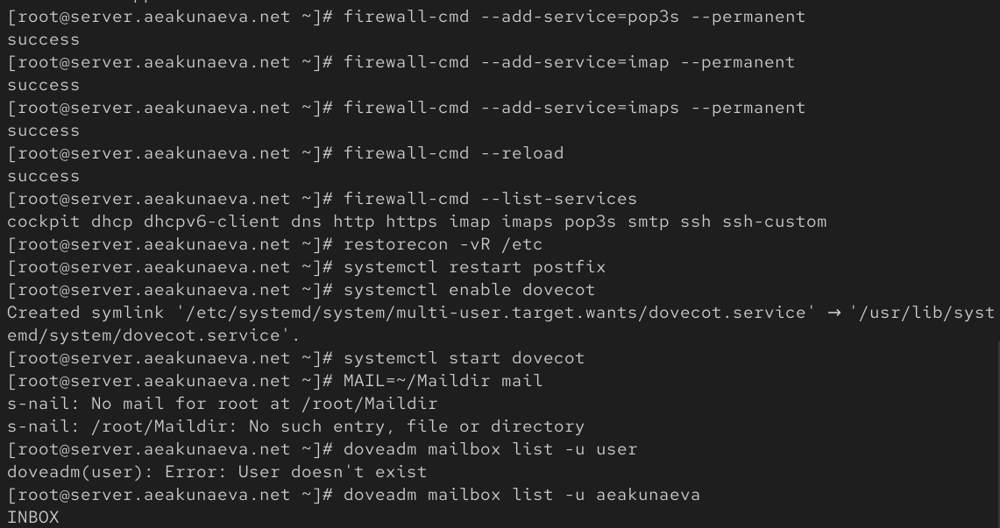
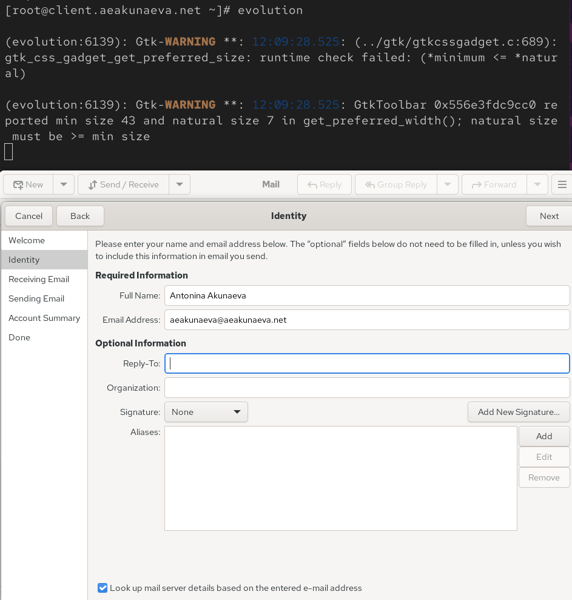
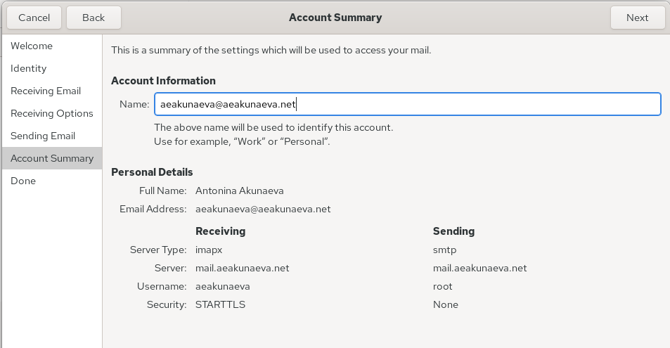
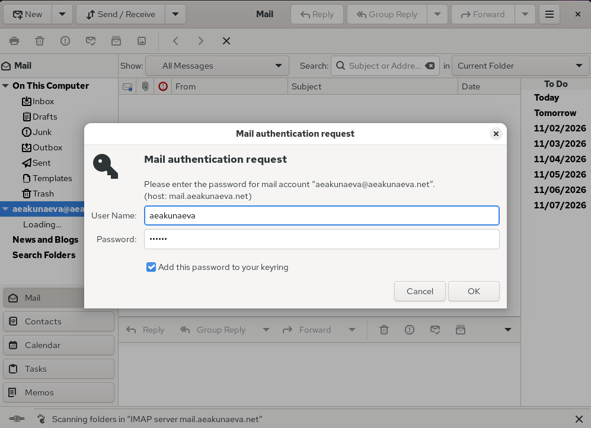
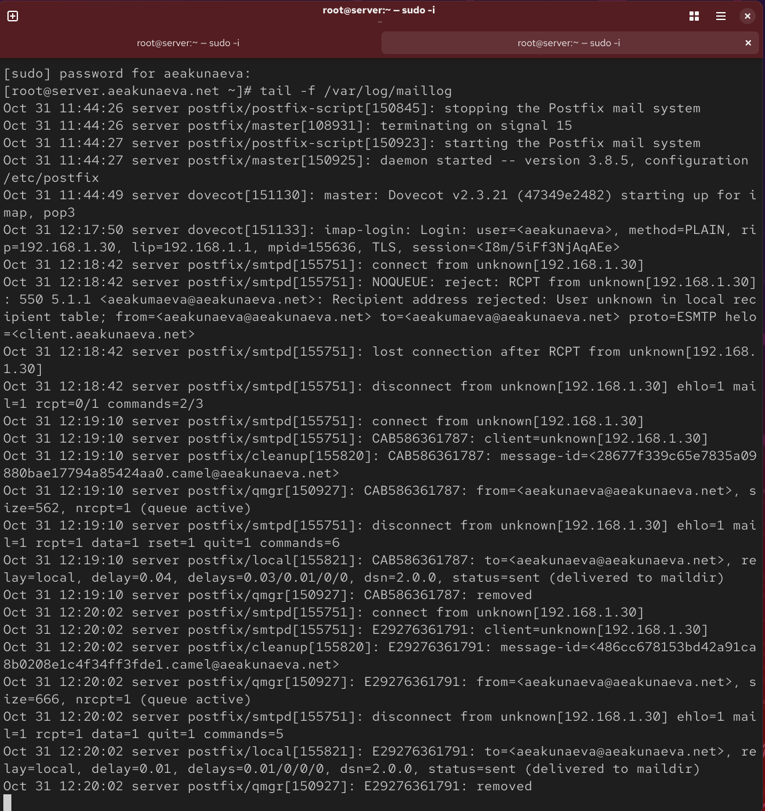

---
## Front matter
lang: ru-RU
title: Лабораторная работа №9
subtitle: Настройка POP3/IMAP сервера
author:
  - Акунаева Антонина Эрдниевна
institute:
  - Российский университет дружбы народов, Москва, Россия
  
date: 2026-10-31

## i18n babel
babel-lang: russian
babel-otherlangs: english

## Formatting pdf
toc: false
toc-title: Содержание
slide_level: 2
aspectratio: 169
section-titles: true
theme: metropolis
header-includes:
 - \metroset{progressbar=frametitle,sectionpage=progressbar,numbering=fraction}
---

# Информация

## Докладчик

:::::::::::::: {.columns align=center}
::: {.column width="70%"}

  * Акунаева Антонина Эрдниевна
  * студент ФФМиЕН, НПИбд-02-24
  * Российский университет дружбы народов
  * [1032240492@rudn.ru](mailto:1032240492@rudn.ru)
  * <https://github.com/Akuxee>

:::
::: {.column width="30%"}

:::
::::::::::::::

# Цели и задачи

- Приобретение практических навыков по установке и простейшему конфигурированию POP3/IMAP-сервера.  

1. Установите на виртуальной машине server Dovecot и Telnet для дальнейшей проверки корректности работы почтового сервера (см. раздел 9.4.1).  

2. Настройте Dovecot (см. раздел 9.4.2).  

3. Установите на виртуальной машине client программу для чтения почты Evolution и настройте её для манипуляций с почтой вашего пользователя. Проверьте корректность работы почтового сервера как с виртуальной машины server, так и с виртуальной машины client (см. раздел 9.4.3).  

4. Измените скрипт для Vagrant, фиксирующий действия по установке и настройке Postfix и Dovecote во внутреннем окружении виртуальной машины server, создайте скрипт для Vagrant, фиксирующий действия по установке Evolution во внутреннем окружении виртуальной машины client. Соответствующим образом внесите изменения в Vagrantfile (см. раздел 9.4.4).  

# Материалы и методы

- Linux (дистрибутив Rocky 10.2)
- Linux Fedora Workstation (Markdown)
- Oracle VirtualBox 7.2.16
- Vagrant 2.4.9 (Windows amd64)
- Dovecot
- Postfix
- Telnet

# Выполнение лабораторной работы

## Установка dovecot и telnet

{#fig:001 width=70%}

## Конфигурационный файл /etc/dovecot/dovecot.conf

{#fig:002 width=70%}

## Конфигурационный файл /etc/dovecot/conf.d/10-auth.conf

{#fig:003 width=70%}

## Конфигурационный файл /etc/dovecot/conf.d/auth-system.conf.ext

{#fig:004 width=70%}

## Конфигурационный файл /etc/dovecot/conf.d/auth-system.conf.ext

{#fig:005 width=70%}

## Конфигурационный файл /etc/dovecot/conf.d/10-mail.conf

{#fig:006 width=70%}

## Задание каталога доставки почты Postfix

{#fig:007 width=70%}

## Настройка межсетевого экрана

{#fig:008 width=70%}

## Запуск и начало работы с Dovecot

{#fig:009 width=70%}

## Мониторинг работы почтовой службы

{#fig:010 width=70%}

## Установка почтового клиента evolution на client

{#fig:011 width=70%}

## Настройка учётной записи Evolution

{#fig:012 width=70%}

## Настройка учётной записи Evolution

{#fig:013 width=70%}

## Настройка учётной записи Evolution

{#fig:014 width=70%}

## Отправление текстовых писем в Evolution

{#fig:015 width=70%}

## Мониторинг работы почтовой службы

{#fig:016 width=70%}

## Проверка работы почтовой службы через Telnet

{#fig:017 width=70%}

## Изменение внутреннего окружения Vagrant

{#fig:018 width=70%}

## Изменение конфигурационного файла /vagrant/provision/server/mail.sh

{#fig:019 width=70%}

## Изменение конфигурационного файла /vagrant/provision/client/mail.sh

{#fig:020 width=70%}

# Выводы

Я приобрела практическик навыки по установке и простейшему конфигурированию POP3/IMAP-сервера.

