---
## Front matter
title: "Отчёт по лабораторной работе №9"
subtitle: "Настройка POP3/IMAP сервера"
author: "Акунаева Антонина Эрдниевна"

## Generic otions
lang: ru-RU
toc-title: "Содержание"

## Bibliography
bibliography: bib/cite.bib
csl: pandoc/csl/gost-r-7-0-5-2008-numeric.csl

## Pdf output format
toc: true # Table of contents
toc-depth: 2
lof: true # List of figures
lot: true # List of tables
fontsize: 12pt
linestretch: 1.5
papersize: a4
documentclass: scrreprt
## I18n polyglossia
polyglossia-lang:
  name: russian
  options:
	- spelling=modern
	- babelshorthands=true
polyglossia-otherlangs:
  name: english
## I18n babel
babel-lang: russian
babel-otherlangs: english
## Fonts
mainfont: IBM Plex Serif
romanfont: IBM Plex Serif
sansfont: IBM Plex Sans
monofont: IBM Plex Mono
mathfont: STIX Two Math
mainfontoptions: Ligatures=Common,Ligatures=TeX,Scale=0.94
romanfontoptions: Ligatures=Common,Ligatures=TeX,Scale=0.94
sansfontoptions: Ligatures=Common,Ligatures=TeX,Scale=MatchLowercase,Scale=0.94
monofontoptions: Scale=MatchLowercase,Scale=0.94,FakeStretch=0.9
mathfontoptions:
## Biblatex
biblatex: true
biblio-style: "gost-numeric"
biblatexoptions:
  - parentracker=true
  - backend=biber
  - hyperref=auto
  - language=auto
  - autolang=other*
  - citestyle=gost-numeric
## Pandoc-crossref LaTeX customization
figureTitle: "Рис."
tableTitle: "Таблица"
listingTitle: "Листинг"
lofTitle: "Список иллюстраций"
lotTitle: "Список таблиц"
lolTitle: "Листинги"
## Misc options
indent: true
header-includes:
  - \usepackage{indentfirst}
  - \usepackage{float} # keep figures where there are in the text
  - \floatplacement{figure}{H} # keep figures where there are in the text
---


# Цель работы

Приобретение практических навыков по установке и простейшему конфигурированию POP3/IMAP-сервера. [@TUIS-lab][@tanenbaum_book_modern-os_ru]

# Задание

1. Установите на виртуальной машине server Dovecot и Telnet для дальнейшей проверки корректности работы почтового сервера (см. раздел 9.4.1).  

2. Настройте Dovecot (см. раздел 9.4.2).  

3. Установите на виртуальной машине client программу для чтения почты Evolution и настройте её для манипуляций с почтой вашего пользователя. Проверьте корректность работы почтового сервера как с виртуальной машины server, так и с виртуальной машины client (см. раздел 9.4.3).  

4. Измените скрипт для Vagrant, фиксирующий действия по установке и настройке Postfix и Dovecote во внутреннем окружении виртуальной машины server, создайте скрипт для Vagrant, фиксирующий действия по установке Evolution во внутреннем окружении виртуальной машины client. Соответствующим образом внесите изменения в Vagrantfile (см. раздел 9.4.4).  

# Выполнение лабораторной работы

**9.4.1. Установка Dovecot**

В виртуальной машине server переходим под нашим пользователем в терминал как суперпользователь и устанавливаем необходимые пакеты для работы с dovecot и telnet ([рис. @fig:001])[@Dovecot-Documentation]:
 
```
sudo -i
dnf -y install dovecot telnet
```

{#fig:001 width=70%}

**9.4.2. Настройка dovecot**

В конфигурационном файле /etc/dovecot/dovecot.conf укажем список почтовых протоколов, по которым разрешено работать Dovecot, добавив строку (можно снять с комментирования) ([рис. @fig:002])[@robbins_book_bash_en]:

```
protocols = imap pop3
```

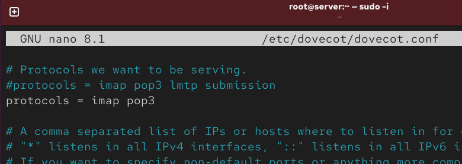{#fig:002 width=70%}

В конфигурационном файле /etc/dovecot/conf.d/10-auth.conf проверим наличие строки ([рис. @fig:003]):

```
auth_mechanisms = plain
```

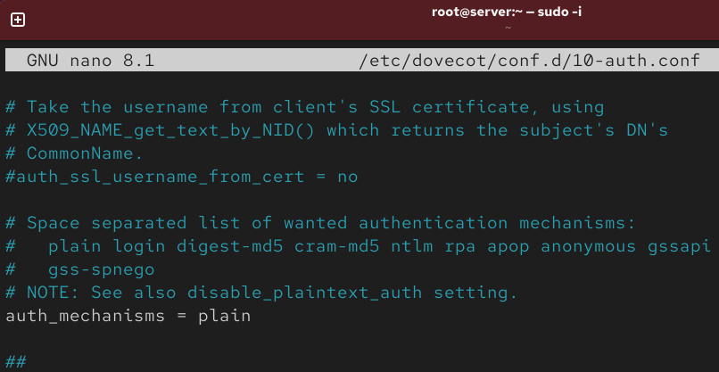{#fig:003 width=70%}

В конфигурационном файле /etc/dovecot/conf.d/auth-system.conf.ext проверим наличие строк ([рис. @fig:004]-[рис. @fig:005])[@zarrelli_book_mastering-bash_en]:

```
passdb {
driver = pam
}
userdb {
driver = passwd
}
```

{#fig:004 width=70%}

{#fig:005 width=70%}

В конфигурационном файле /etc/dovecot/conf.d/10-mail.conf настроим месторасположение почтовых ящиков пользователей ([рис. @fig:006])[@newham_book_learning-bash_en]:

```
mail_location = maildir:~/Maildir
```

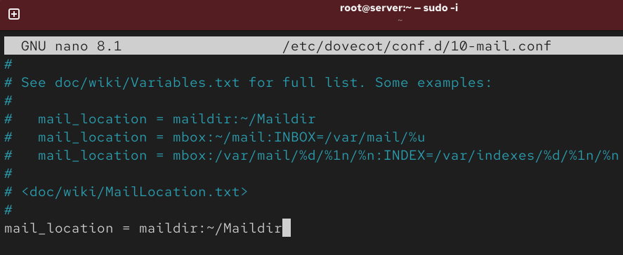{#fig:006 width=70%}

В Postfix зададим каталог для доставки почты ([рис. @fig:007])[@Postfix-Documentation]:

```
postconf -e 'home_mailbox = Maildir/'
```

И сконфигурируем межсетевой экран, разрешив работать службам протоколов POP3и IMAP ([рис. @fig:008]-[рис. @fig:009]):

```
firewall-cmd --get-services
firewall-cmd --add-service=pop3 --permanent
firewall-cmd --add-service=pop3s --permanent
firewall-cmd --add-service=imap --permanent
firewall-cmd --add-service=imaps --permanent
firewall-cmd --reload
firewall-cmd --list-services
```

Восстановим контекст безопасности в SELinux:

```
restorecon -vR /etc
```

Перезапустим Postfix и запустите Dovecot:

```
systemctl restart postfix
systemctl enable dovecot
systemctl start dovecot
```

Для просмотра имеющейся почты используем (писем не нашлось):

```
MAIL=~/Maildir mail
```

Для просмотра mailbox пользователя на сервере на терминале с правами суперпользователя можем использовать команду:

```
doveadm mailbox list -u aeakunaeva
```

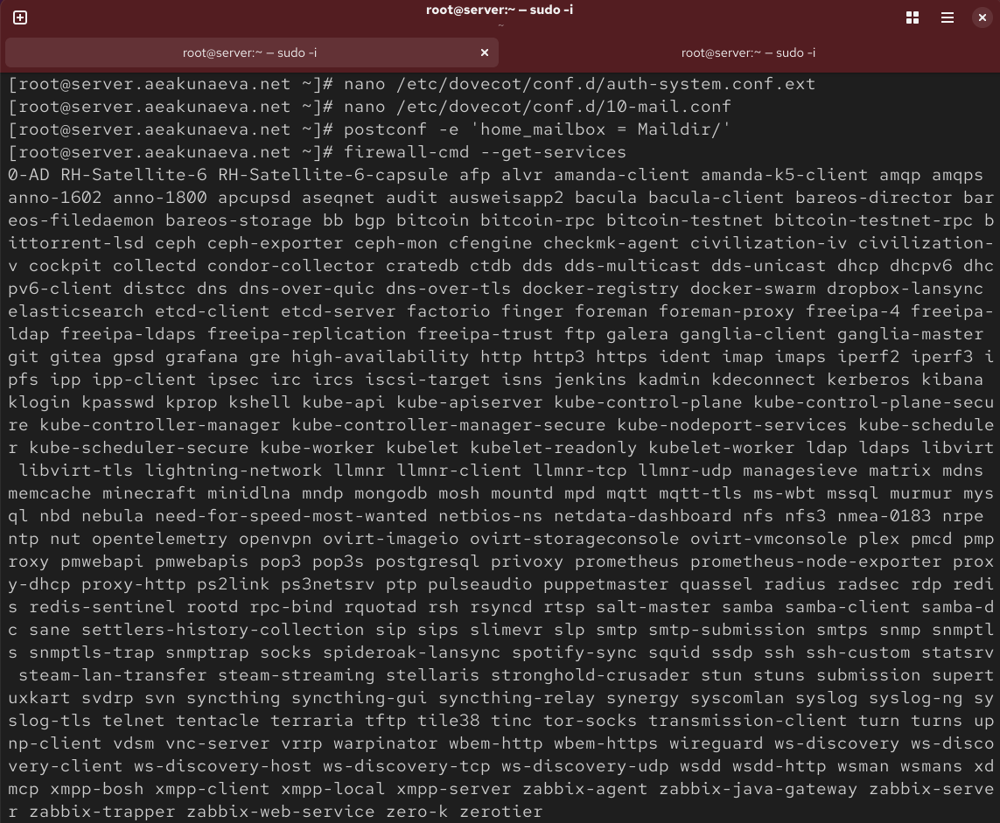{#fig:007 width=70%}

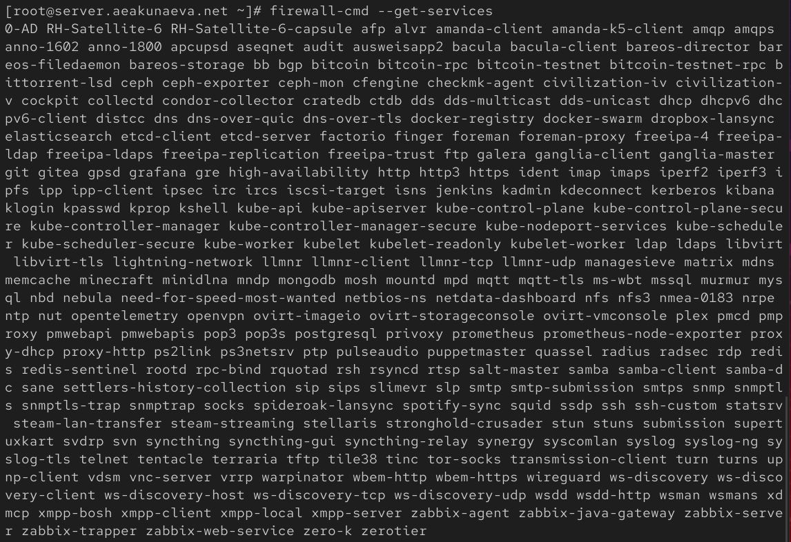{#fig:008 width=70%}

{#fig:009 width=70%}

**9.4.3. Проверка работы Dovecot**

На дополнительном терминале запустим мониторинг работы почтовой службы и убедимся, что Dovecot запущен с нужными протоколами ([рис. @fig:010]):
 
```
tail -f /var/log/maillog
```

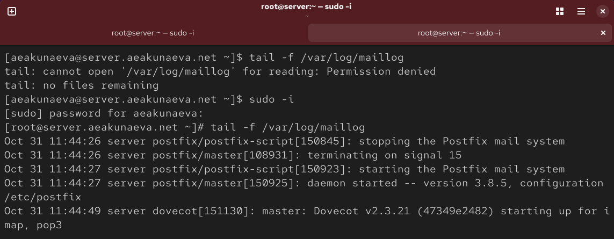{#fig:010 width=70%}

На виртуальной машине client зайдём в терминал как суперпользователь и установим почтовый клиент evolution ([рис. @fig:011]):

```
sudo -i
dnf -y install evolution
```

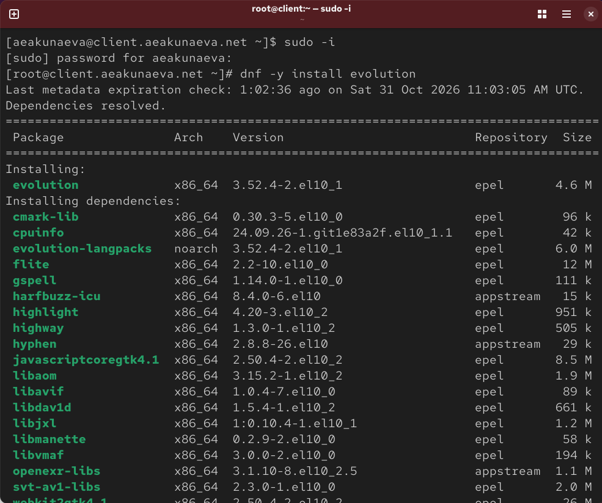{#fig:011 width=70%}

Запустим и настроим почтовый клиент Evolution ([рис. @fig:012]-[рис. @fig:013]):

```
evolution
```

– в окне настройки учётной записи почты укажем имя **(Antonina Akunaeva)**, адрес почты в виде
**(aeakunaeva@aeakunaeva.net)**;  

– в качестве IMAP-сервера **(порт 143)** для входящих сообщений и SMTP-сервера **(порт 25)** для исходящих сообщений - **(aeakunaeva@aeakunaeva.net)**, в качестве пользователя для входящих **aeakunaeva**;  

– настройки SSL и метода аутентификации: для IMAP - **STARTTLS, аутентификация по обычному паролю**, для SMTP - **без аутентификации**;  

– Установим пароль для учётной записи и подтвердим исключение безопасности, нажав в появившемся окне соответствующую кнопку. ([рис. @fig:014])

{#fig:012 width=70%}

{#fig:013 width=70%}

{#fig:014 width=70%}

Нажав на кнопку в левом верхнем углу по созданию нового письма, отправим себе пару писем test1 и test2, указав адрес aeakunaeva@aeakunaeva.net и убедимся, что все письма появилис во Входящих ([рис. @fig:015]):

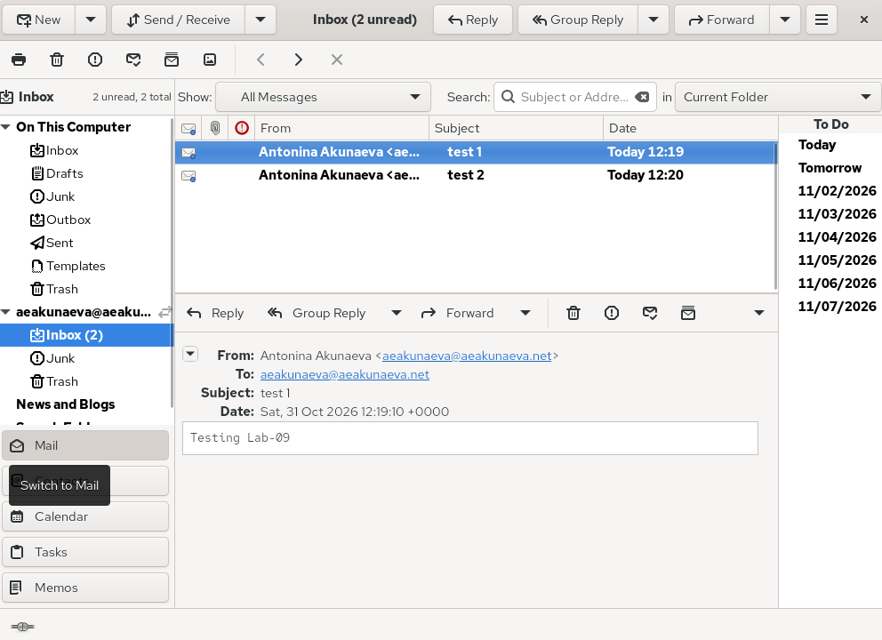{#fig:015 width=70%}

На виртуальной машине server во втором терминале просмотрим журнал мониторинга почтовой службы ([рис. @fig:016]):

- Успешный перезапуск служб Postfix и Dovecot.  

- Успешная аутентификация пользователя в Dovecot по протоколу IMAP из почтового клиента Evolution (IP 192.168.1.30, метод PLAIN, TLS).  

- При попытке отправки письма на адрес с опечаткой (aeakumaeva) сервер корректно отклонил письмо с ошибкой 550 5.1.1 User unknown.  

- При отправке писем на правильный адрес (aeakunaeva) Postfix успешно их принимал (логи postfix/smtpd), а затем доставлял в локальный ящик (status=sent (delivered to maildir)).  

{#fig:016 width=70%}

Проверим работу почтовой службы, используя на сервере протокол Telnet([рис. @fig:017]):

-  подключимся с помощью протокола Telnet к почтовому серверу по протоколу POP3 (через порт 110), введя свои данные:  

```
telnet mail.aeakunaeva.net 110
user aeakunaeva
pass 123456
```

– с помощью команды list получим список писем (два письма):  

```
list
```

– с помощью команды retr 1 получим первое письмо из списка:  

```
retr 1
```

– с помощью команды dele 2 удалим второе письмо из списка:  

```
dele 2
```

– с помощью команды quit завершим сеанс работы с telnet:  

```
quit
```

{#fig:017 width=70%}

**9.4.4. Внесение изменений в настройки внутреннего окружения виртуальной машины**

Перейдём в каталог для внесения изменений в настройки внутреннего окружения /vagrant/provision/server/. В соответствующие подкаталоги поместим конфигурационные файлы Dovecot ([рис. @fig:018]):

```
cd /vagrant/provision/server
mkdir -p /vagrant/provision/server/mail/etc/dovecot/conf.d
cp -R /etc/dovecot/dovecot.conf /vagrant/provision/server/mail/etc/dovecot/
cp -R /etc/dovecot/conf.d/10-auth.conf /vagrant/provision/server/mail/etc/dovecot/conf.d/
cp -R /etc/dovecot/conf.d/auth-system.conf.ext /vagrant/provision/server/mail/etc/dovecot/conf.d/
cp -R /etc/dovecot/conf.d/10-mail.conf /vagrant/provision/server/mail/etc/dovecot/conf.d/
```

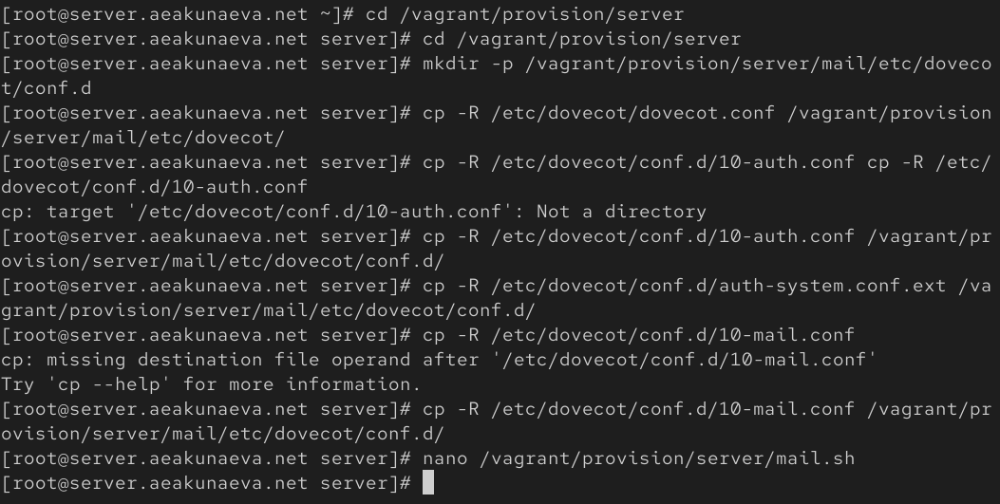{#fig:018 width=70%}

Внесём изменения в файл /vagrant/provision/server/mail.sh, добавив в него строки через nano ([рис. @fig:019]):

```
nano /vagrant/provision/server/mail.sh
```

– по установке Dovecot и Telnet:  

```
dnf -y install dovecot telnet
```

– по настройке межсетевого экрана:  

```
postconf -e 'home_mailbox = Maildir/'
```

– по настройке Postfix в части задания месторасположения почтового ящика:  

```
firewall-cmd --add-service=pop3 --permanent
firewall-cmd --add-service=pop3s --permanent
firewall-cmd --add-service=imap --permanent
firewall-cmd --add-service=imaps --permanent
firewall-cmd --reload

restorecon -vR /etc
```

– по перезапуску Postfix и запуску Dovecot:  

```
systemctl restart postfix
systemctl enable dovecot
systemctl start dovecot
```

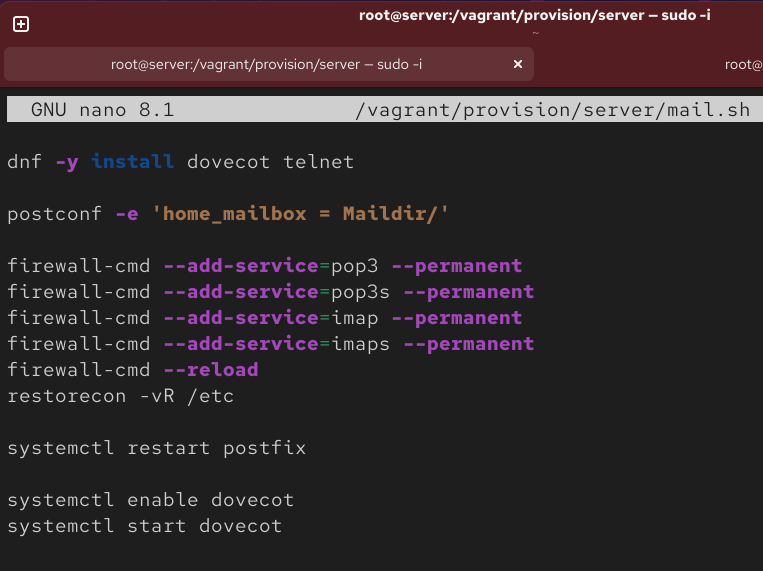{#fig:019 width=70%}

На виртуальной машине client откроем файл /vagrant/provision/client/mail.sh, добавив в него установку Evolution ([рис. @fig:020]):

```
dnf -y install evolution
```

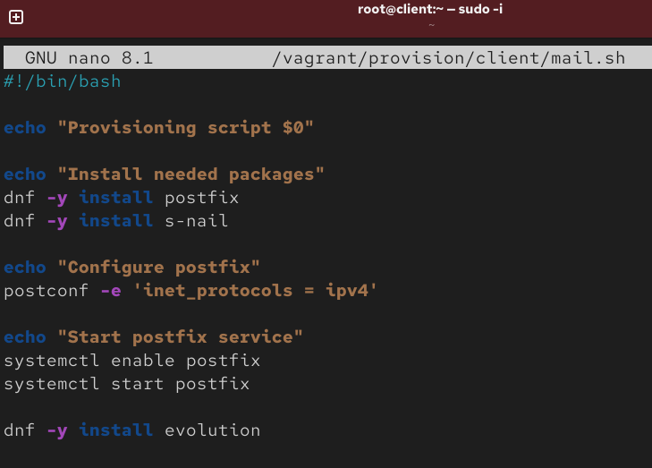{#fig:020 width=70%}


# Контрольные вопросы

1. **За что отвечает протокол SMTP?**  

SMTP передаёт/отправляет почту: от клиента на сервер и между серверами по порту 25 (587/465).  

2. **За что отвечает протокол IMAP?**  

IMAP даёт доступ к ящику на сервере: папки, поиск, флаги, синхронизация между устройствами, порт 143 (993). Письма при этом остаются на сервере.  

3. **За что отвечает протокол POP3?**  

POP3 скачивает письма из ящика на клиент, обычно с удалением с сервера, порт 110 (995).  

4. **В чём назначение Dovecot?**  

Dovecot - это MDA-сервер для POP3/IMAP с TLS: хранит и отдаёт ящики (mbox/Maildir), аутентифицирует пользователей, взаимодействует с Postfix.  

5. **В каких файлах обычно находятся настройки работы Dovecot? За что отвечает каждый из файлов?**  

НАстройки Dovecot обычно хранятся в /etc/dovecot/dovecot.conf (протоколы), conf.d/10-auth.conf (механизмы аутентификации), conf.d/auth-system.conf.ext (pam/passwd), conf.d/10-mail.conf (расположение ящиков), conf.d/10-ssl.conf (TLS), сертификаты в /etc/pki/dovecot.  

6. **В чём назначение Postfix?**  

Postfix MTA принимает, маршрутизирует и пересылает почту по SMTP, ведёт очередь, доставляет локально (сам или через Dovecot).  

7. **Какие методы аутентификации пользователей можно использовать в Dovecot и в чём их отличие?**  

- plain/login (пароль открыто, нужен TLS);  

- cram-md5/digest-md5/ntlm/gssapi (challenge-response, пароль не передаётся).  

Отличие в способе передачи пароля и бэкенд проверки (PAM, passwd, LDAP, SQL).  

8. **Приведите пример заголовка письма с пояснениями его полей.**

From: User <aeakunaeva@aeakunaeva.net> - отправитель  
To: User <aeakunaeva@user.net> - получатель  
Subject: Test - тема (заголовок)  
Date: Mon, 20 Sep 2021 10:15:29 +0300 - дата отправки письма  
Message-ID: <123456789@aeakunaeva.net> - ID письма, его персональный номер  

Также Received - цепочка серверов, Return-Path - адрес возврата.  

9. **Приведите примеры использования команд для работы с почтовыми протоколами через терминал (например через telnet).**

telnet mail.user.net 110 - user <user> - pass <password> - list - retr 1 - dele 2 - quit ([рис. @fig:021]):

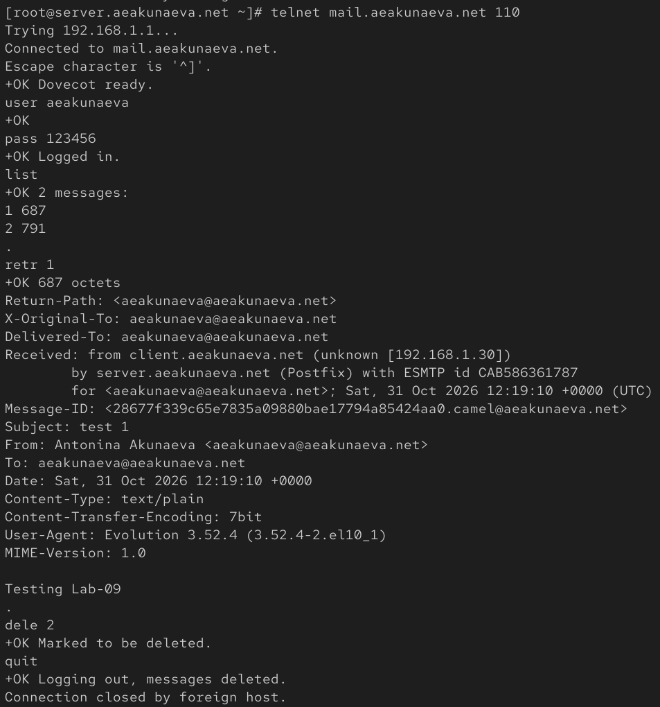{#fig:021 width=70%}

10. **Приведите примеры с пояснениями по работе с doveadm.**

doveadm mailbox list -u user - список папок  
doveadm search -u user mailbox INBOX all - поиск писем  
doveadm auth test user pass - проверка аутентификации  
doveadm reload - перечитать конфиг  


# Выводы

Я приобрела практическик навыки по установке и простейшему конфигурированию POP3/IMAP-сервера.

# Список литературы{.unnumbered} 

::: {#refs}
:::
