---
## Front matter
title: "Отчёт по лабораторной работе №10"
subtitle: "Расширенные настройки SMTP-сервера"
author: "Акунаева Антонина Эрдниевна"

## Generic otions
lang: ru-RU
toc-title: "Содержание"

## Bibliography
bibliography: bib/cite.bib
csl: pandoc/csl/gost-r-7-0-5-2008-numeric.csl

## Pdf output format
toc: true # Table of contents
toc-depth: 2
lof: true # List of figures
lot: true # List of tables
fontsize: 12pt
linestretch: 1.5
papersize: a4
documentclass: scrreprt
## I18n polyglossia
polyglossia-lang:
  name: russian
  options:
	- spelling=modern
	- babelshorthands=true
polyglossia-otherlangs:
  name: english
## I18n babel
babel-lang: russian
babel-otherlangs: english
## Fonts
mainfont: IBM Plex Serif
romanfont: IBM Plex Serif
sansfont: IBM Plex Sans
monofont: IBM Plex Mono
mathfont: STIX Two Math
mainfontoptions: Ligatures=Common,Ligatures=TeX,Scale=0.94
romanfontoptions: Ligatures=Common,Ligatures=TeX,Scale=0.94
sansfontoptions: Ligatures=Common,Ligatures=TeX,Scale=MatchLowercase,Scale=0.94
monofontoptions: Scale=MatchLowercase,Scale=0.94,FakeStretch=0.9
mathfontoptions:
## Biblatex
biblatex: true
biblio-style: "gost-numeric"
biblatexoptions:
  - parentracker=true
  - backend=biber
  - hyperref=auto
  - language=auto
  - autolang=other*
  - citestyle=gost-numeric
## Pandoc-crossref LaTeX customization
figureTitle: "Рис."
tableTitle: "Таблица"
listingTitle: "Листинг"
lofTitle: "Список иллюстраций"
lotTitle: "Список таблиц"
lolTitle: "Листинги"
## Misc options
indent: true
header-includes:
  - \usepackage{indentfirst}
  - \usepackage{float} # keep figures where there are in the text
  - \floatplacement{figure}{H} # keep figures where there are in the text
---


# Цель работы

Приобретение практических навыков по конфигурированию SMTP-сервера в части настройки аутентификации. [@TUIS-lab][@tanenbaum_book_modern-os_ru]

# Задание

1. Настройте Dovecot для работы с LMTP (см. раздел 10.4.1).  

2. Настройте аутентификацию посредством SASL на SMTP-сервере (см. раздел 10.4.2).  

3. Настройте работу SMTP-сервера поверх TLS (см. раздел 10.4.3).  

4. Скорректируйте скрипт для Vagrant, фиксирующий действия расширенной настройки SMTP-сервера во внутреннем окружении виртуальной машины server (см. раздел 10.4.4).  

# Выполнение лабораторной работы

**10.4.1. Настройка LMTP в Dovecote**

На виртуальной машине server войдём под нашим пользователем, откроем терминал и зайдём как суперпользователь, введя пароль ([рис. @fig:001]):

```
sudo -i
```

Далее откроем для редактирования конфигурационные файлы dovecot (на следующих изображениях) из файла лабораторной для дальнейшей работы. После изменения файлов также переопределим в Postfix передачу сообщений с прямой на через заданный unix-сокет с помощью postfix:

```
postconf -e 'mailbox_transport = lmtp:unix:private/dovecot-lmtp'
```

После внесения изменений перезапустим postfix и dovecot:

```
systemctl restart postfix
systemctl restart dovecot
```

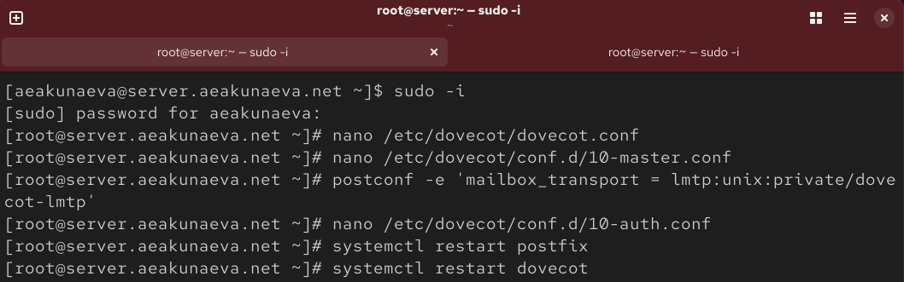{#fig:001 width=70%}

В дополнительном терминале для мониторинга работы почтовой службы запустим журнал ([рис. @fig:002])[@robbins_book_bash_en]:

```
sudo -i
tail -f /var/log/maillog
```

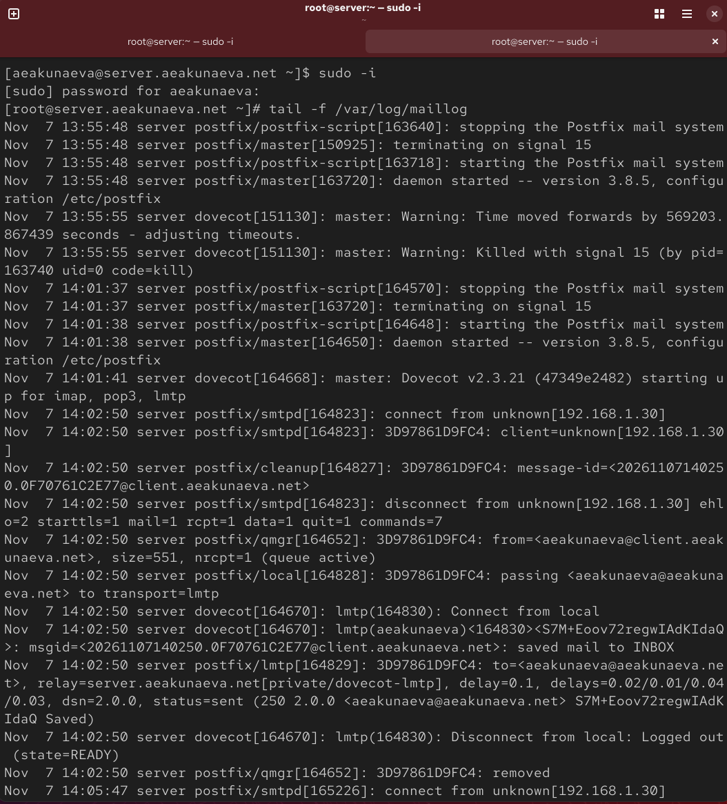{#fig:002 width=70%}

В конфигурационном файле /etc/dovecot/dovecot.conf добавим в список протоколов, с которыми может работать Dovecot, протокол LMTP ([рис. @fig:003]):

```
protocols = imap pop3 lmtp
```

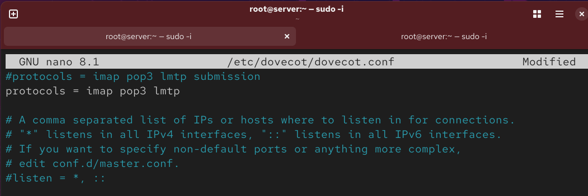{#fig:003 width=70%}

В конфигурационном файле /etc/dovecot/conf.d/10-master.conf настроим сервис lmtp для связи с Postfix, заменив определение сервиса lmtp на ([рис. @fig:004]):

```
service lmtp {
unix_listener /var/spool/postfix/private/dovecot-lmtp {
group = postfix
user = postfix
mode = 0600
}
}
```

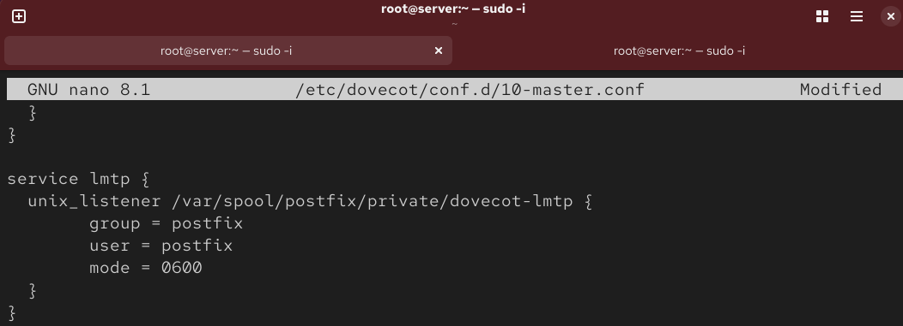{#fig:004 width=70%}

В конфигурационном файле etc/dovecot/conf.d/10-auth.conf зададим формат имени пользователя, убрав его из-под комментария, в форме логина пользователя без указания домена ([рис. @fig:005])[@zarrelli_book_mastering-bash_en]:

```
auth_username_format = %Ln
```

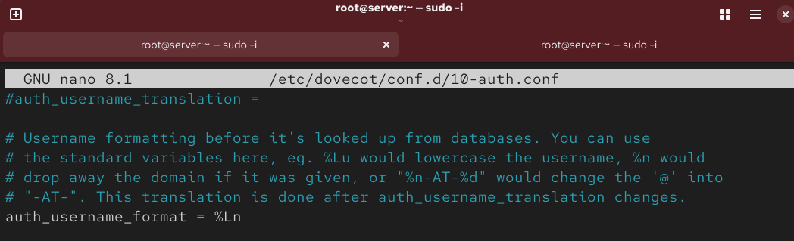{#fig:005 width=70%}

На виртуальной машине client откроем терминал и отправим письмо для проверки работы LMTP, указав наш адрес ([рис. @fig:006])[@newham_book_learning-bash_en]:

```
echo .| mail -s "LMTP test" aeakunaeva@aeakunaeva.net
```

При отправке тестового письма в логе /var/log/maillog отображается корректная цепочка доставки почты:

- Postfix принимает письмо от локального пользователя и передаёт его агенту доставки через UNIX-сокет (lmtp:unix:private/dovecot-lmtp).  

- Служба lmtp в Dovecot получает запрос, определяет локального пользователя (в данном случае aeakunaeva) и путь к его почтовому ящику.  

- Dovecot успешно сохраняет письмо в формате Maildir (в подкаталог new), о чём свидетельствует запись saved mail to INBOX. Это подтверждает, что связка Postfix + Dovecot LMTP настроена и работает корректно.  

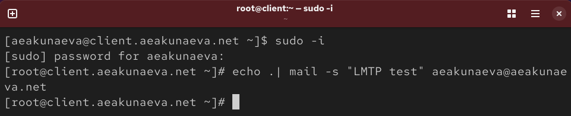{#fig:006 width=70%}

Выйдя из суперпользователя, проверим почту на server ([рис. @fig:007]):

```
MAIL=~/Maildir/ mail
```

Письмо было доставлено (как и все, которые мы могли бы отправить): LMTP test

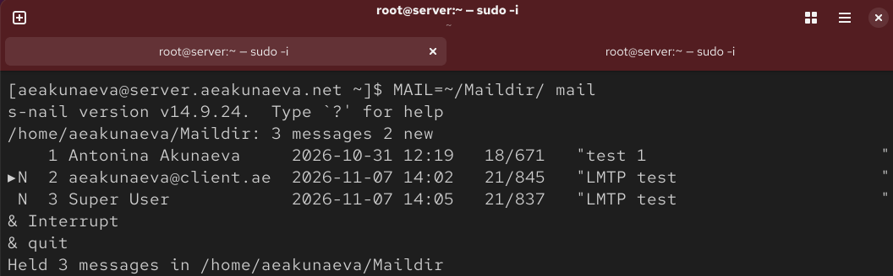{#fig:007 width=70%}

**10.4.2. Настройка SMTP-аутентификации**

В конфигурационном файле /etc/dovecot/conf.d/10-master.conf определим службу аутентификации пользователей ([рис. @fig:008]):

```
service auth {
unix_listener /var/spool/postfix/private/auth {
group = postfix
user = postfix
mode = 0660
}
unix_listener auth-userdb {
mode = 0600
user = dovecot
}
}
```

- service auth { ... } – определяет параметры службы аутентификации Dovecot.  

- unix_listener /var/spool/postfix/private/auth { ... } – создаёт UNIX-сокет для связи с Postfix. Путь указывает на chroot-окружение Postfix, чтобы демон мог получить к нему доступ.  

- group = postfix и user = postfix – назначает владельцами сокета пользователя и группу postfix, давая почтовому серверу необходимые права.  

- mode = 0660 – устанавливает права доступа к сокету (чтение и запись только для владельца и группы), что обеспечивает безопасность канала аутентификации.  

- unix_listener auth-userdb { ... } – создаёт внутренний сокет для обращения Dovecot к своей базе данных пользователей (userdb).  

- mode = 0600 и user = dovecot – строго ограничивает доступ к этому внутреннему сокету только для пользователя dovecot, запрещая доступ любым другим процессам в системе.  

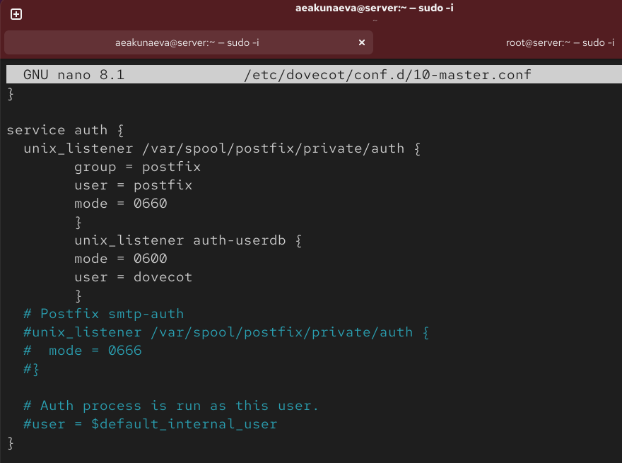{#fig:008 width=70%}

В конфигурационном файле /etc/postfix/master.cf заменим схожую строку на ([рис. @fig:009]):

```
mtp inet n - n - - smtpd
-o smtpd_sasl_auth_enable=yes
-o smtpd_recipient_restrictions=reject_non_fqdn_recipient,reject_unknown_recipient_domain,permit_sasl_authenticated,reject
```

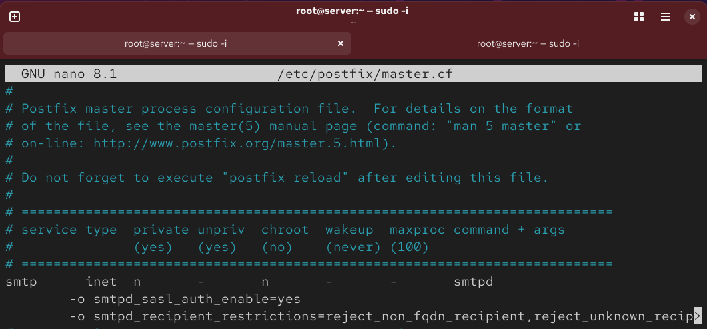{#fig:009 width=70%}

Для Postfix зададим тип аутентификации SASL для smtpd и путь к соответствующему unix-сокету ([рис. @fig:010]):
 
 ```
postconf -e 'smtpd_sasl_type = dovecot'
postconf -e 'smtpd_sasl_path = private/auth'
```

Также настроим Postfix для приёма почты из Интернета только для обслуживаемых нашим сервером пользователей или для произвольных пользователей локальной машины:

```
postconf -e 'smtpd_recipient_restrictions = reject_unknown_recipient_domain, permit_mynetworks, reject_non_fqdn_recipient, reject_unauth_destination, reject_unverified_recipient, permit'
```
Параметр smtpd_recipient_restrictions задаёт список правил, которые Postfix применяет к команде RCPT TO (адресу получателя). Проверка идёт слева направо до первого совпадения:  

- reject_unknown_recipient_domain – отклоняет письма, если домен получателя не имеет корректных DNS-записей (A или MX). Защищает от спама с несуществующими доменами.  

- permit_mynetworks – разрешает пересылку почты без дополнительных проверок для клиентов, чьи IP-адреса входят в список доверенных сетей (в нашей настройке это только 127.0.0.0/8).  

- reject_non_fqdn_recipient – отклоняет письма, если адрес получателя не является полностью квалифицированным доменным именем (FQDN), например, просто user вместо user@aeakunaeva.net.  

- reject_unauth_destination – ключевое правило безопасности. Запрещает принимать почту для доменов, которые не обслуживаются данным сервером (не указаны в mydestination и т.д.). Это предотвращает использование сервера как открытого релея (Open Relay) для спам-рассылок.  

- reject_unverified_recipient - отклоняет письмо, если адрес локального получателя не проходит проверку на существование в системе.  

- permit – разрешает доставку письма, если оно успешно прошло все предыдущие проверки (например, для аутентифицированных пользователей или легитимных локальных адресов).  

В настройках Postfix ограничим приём почты только локальным адресом SMTP-сервера сети:

```
postconf -e 'mynetworks = 127.0.0.0/8
```

После настройки перезапустим Postfix и Dovecot:

```
systemctl restart postfix
systemctl restart dovecot
```

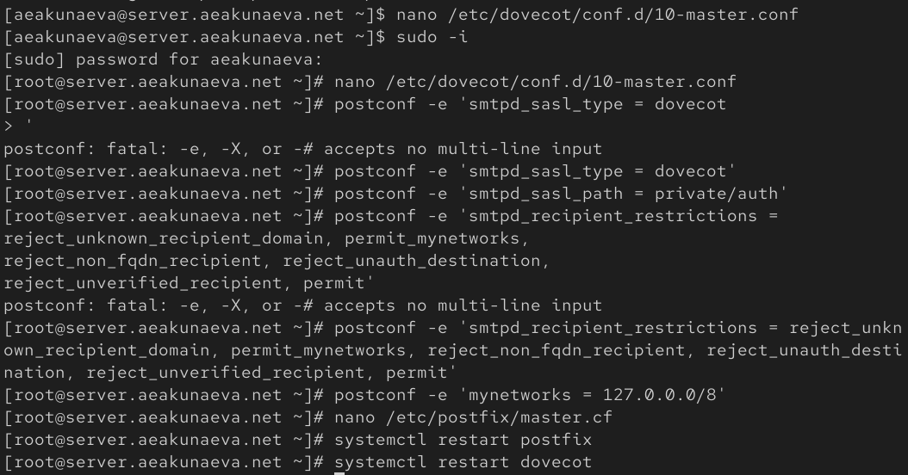{#fig:010 width=70%}

На client установим telnet ([рис. @fig:011]):

```
sudo -i
dnf -y install telnet
```

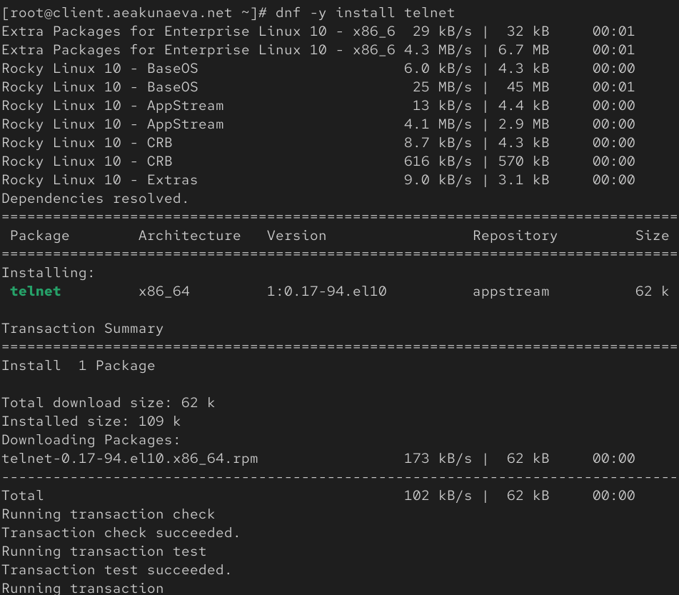{#fig:011 width=70%}

На client также получим строку для аутентификации, указав логин и пароль ([рис. @fig:012]):

```
printf 'aeakunaeva\x00aeakunaeva\x00123456' | base64
```

Подключимся на клиенте к SMTP-серверу посредством telnet и протестируем соединение:

```
telnet server.aeakunaeva.net 25
EHLO test
```

Проверим авторизацию, введя ранее полученную строку для аутентификации:

```
AUTH PLAIN YWVha3VuYWV2YQBhZWFrdW5hZXZhADEyMzQ1Ng==
```

Затем завершим сессию telnet на client:

```
quit
```

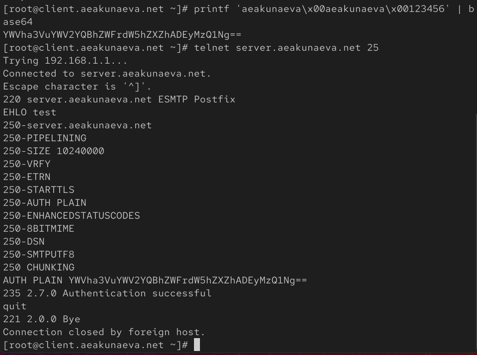{#fig:012 width=70%}

**10.4.3. Настройка SMTP over TLS**

На виртуальной машине server предварительно скопируем необходимые файлы сертификата и ключа из каталога /etc/pki/dovecot в каталог /etc/pki/tls/ в соответствующие подкаталоги (чтобы не было проблем с SELinux) ([рис. @fig:013]):

```
cp /etc/pki/dovecot/certs/dovecot.pem /etc/pki/tls/certs
cp /etc/pki/dovecot/private/dovecot.pem /etc/pki/tls/private
```

Сконфигурируем Postfix, указав пути к сертификату и ключу, а также к каталогу для хранения TLS-сессий и уровень безопасности:

```
postconf -e 'smtpd_tls_cert_file=/etc/pki/tls/certs/dovecot.pem'
postconf -e 'smtpd_tls_key_file=/etc/pki/tls/private/dovecot.pem'
postconf -e 'smtpd_tls_session_cache_database = btree:/var/lib/postfix/smtpd_scache'
postconf -e 'smtpd_tls_security_level = may'
postconf -e 'smtp_tls_security_level = may'
```

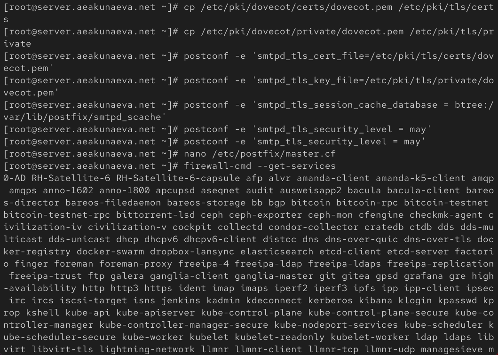{#fig:013 width=70%}

Для того чтобы запустить SMTP-сервер на 587-м порту, в файле /etc/postfix/master.cf заменим необходимые строки на ([рис. @fig:014]):

```
smtp inet n - n - - smtpd
submission inet n - n - - smtpd
-o smtpd_tls_security_level=encrypt
-o smtpd_sasl_auth_enable=yes
-o smtpd_recipient_restrictions=reject_non_fqdn_recipient,reject_unknown_recipient_domain,permit_sasl_authenticated,reject
```

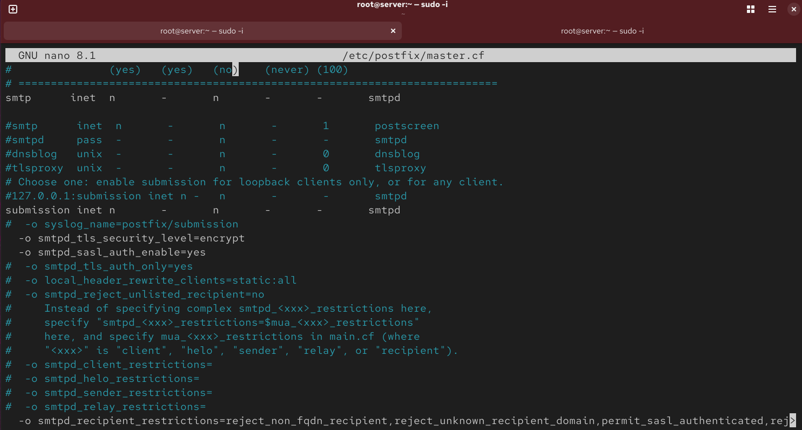{#fig:014 width=70%}

Настроим межсетевой экран, разрешив работать службе smtp-submission ([рис. @fig:015]):

```
firewall-cmd --get-services
firewall-cmd --add-service=smtp-submission
firewall-cmd --add-service=smtp-submission --permanent
firewall-cmd --reload
```

И перезапустим Postfix:

```
systemctl restart postfix
```

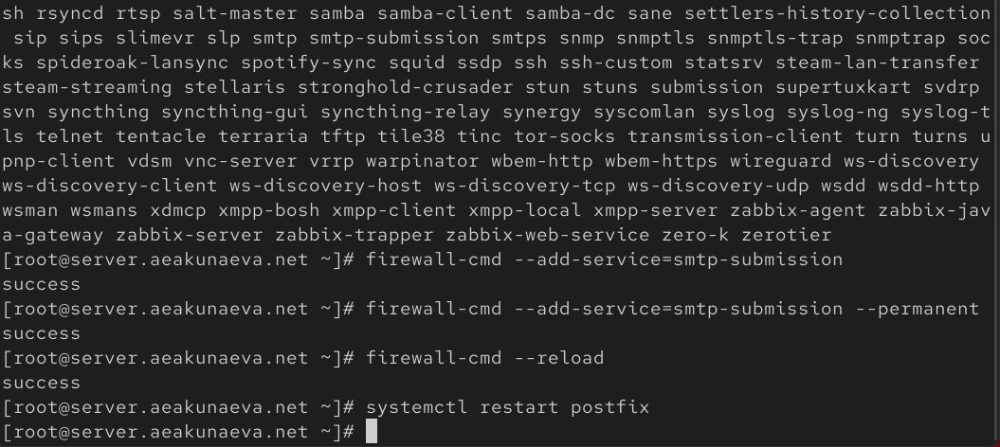{#fig:015 width=70%}

На client подключитесь к SMTP-серверу через 587-й порт посредством openssl, протестируем подключение по telnet и проверим аутентификацию ([рис. @fig:016]-[рис. @fig:017]):

```
openssl s_client -starttls smtp -crlf -connect server.aeakunaeva.net:587
EHLO test
AUTH PLAIN YWVha3VuYWV2YQBhZWFrdW5hZXZhADEyMzQ1Ng==
```

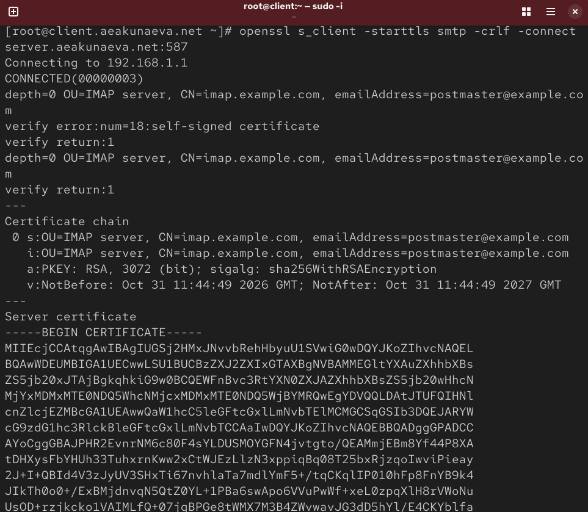{#fig:016 width=70%}

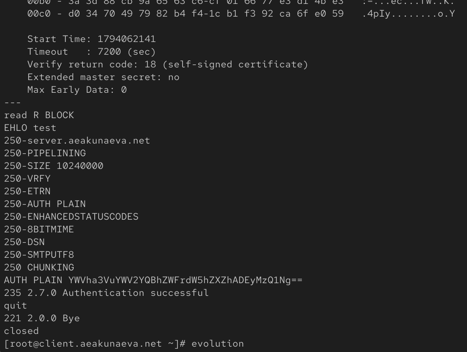{#fig:017 width=70%}

Откроем Evolution на client ([рис. @fig:018]):

```
evolution
```

Откроем настройки учётной записи пользователя и в графе Sending Email изменим порт на 587, метод шифрования на STARTTLS и включим проверку пароля plaintext. Отправим себе письмо на адрес aeakunaeva@aeakunaeva.net.

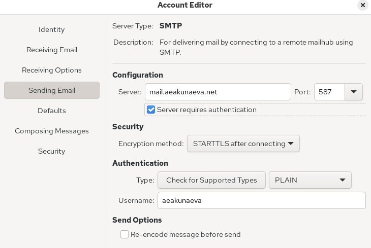{#fig:018 width=70%}

На server проверим от пользователя aeakunaeva, приходят ли письма с client ([рис. @fig:019]):

```
su - aeakunaeva
MAIL=~/Maildir/ mail
```

Действительно увидим отправленные письма, в частности новое письмо test SMTP.

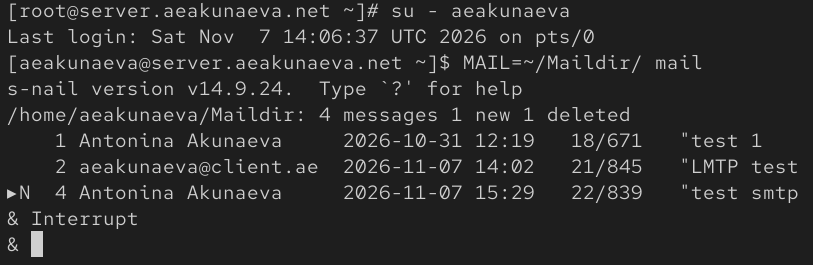{#fig:019 width=70%}

**10.4.4. Внесение изменений в настройки внутреннего окружения виртуальной машины**

На виртуальной машине server перейдём в рабочий каталог для внесения изменений в настройки внутреннего окружения /vagrant/provision/server/. В соответствующие подкаталоги поместим конфигурационные файлы Dovecot и Postfix ([рис. @fig:020]):

```
cd /vagrant/provision/server
cp -R /etc/dovecot/dovecot.conf /vagrant/provision/server/mail/etc/dovecot/
cp -R /etc/dovecot/conf.d/10-master.conf /vagrant/provision/server/mail/etc/dovecot/conf.d/
cp -R /etc/dovecot/conf.d/10-auth.conf /vagrant/provision/server/mail/etc/dovecot/conf.d/
mkdir -p /vagrant/provision/server/mail/etc/postfix/
cp -R /etc/postfix/master.cf /vagrant/provision/server/mail/etc/postfix/
```

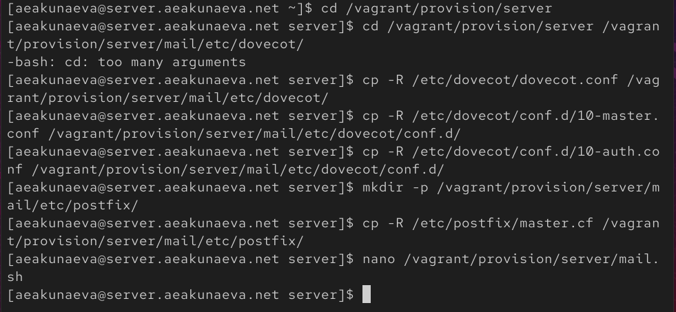{#fig:020 width=70%}

Внесём соответствующие изменения по расширенной конфигурации SMTP-сервера в файл /vagrant/provision/server/mail.sh ([рис. @fig:021]):

```
#!/bin/bash
echo "Provisioning script $0"
echo "Install needed packages"
dnf -y install postfix
dnf -y install dovecot
dnf -y install telnet
echo "Copy configuration files"
cp -R /vagrant/provision/server/mail/etc/* /etc
chown -R root:root /etc/postfix
restorecon -vR /etc
echo "Configure firewall"
firewall-cmd --add-service smtp --permanent
firewall-cmd --add-service pop3 --permanent
firewall-cmd --add-service pop3s --permanent
firewall-cmd --add-service imap --permanent
firewall-cmd --add-service imaps --permanent
firewall-cmd --add-service smtp-submission --permanent
firewall-cmd --reload
echo "Start postfix service"
systemctl enable postfix
systemctl start postfix
echo "Configure postfix"
postconf -e 'mydomain = user.net'
postconf -e 'myorigin = $mydomain'
postconf -e 'inet_protocols = ipv4'
postconf -e 'inet_interfaces = all'
postconf -e 'mydestination = $myhostname, localhost.$mydomain, localhost, $mydomain'
#postconf -e 'mynetworks = 127.0.0.0/8, 192.168.0.0/16'
echo "Configure postfix for dovecot"
postconf -e 'home_mailbox = Maildir/'
echo "Configure postfix for auth"
postconf -e 'smtpd_sasl_type = dovecot'
postconf -e 'smtpd_sasl_path = private/auth'
```

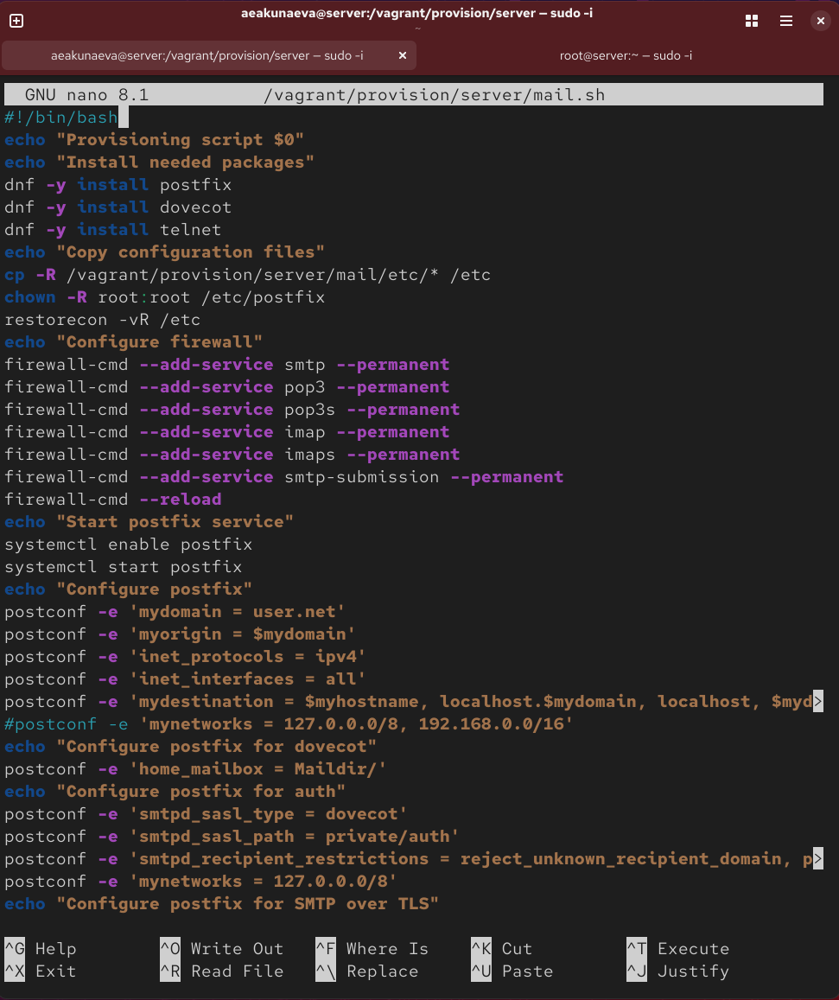{#fig:021 width=70%}

Внесём изменения в файл /vagrant/provision/client/mail.sh, добавив установку telnet ([рис. @fig:022]):

```
dnf -y install telnet
```

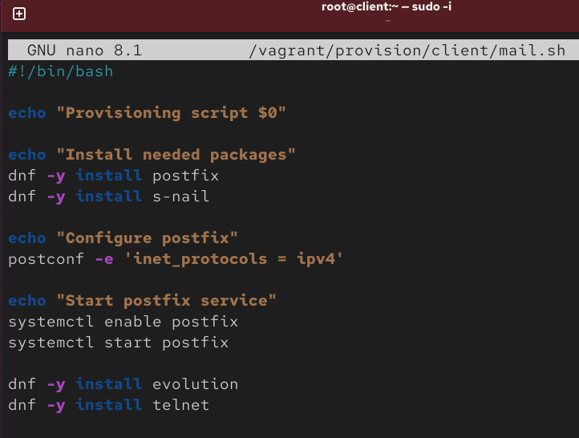{#fig:022 width=70%}


# Контрольные вопросы

1. **Приведите пример задания формата аутентификации пользователя в Dovecot в форме логина с указанием домена.**  

Для аутентификации в формате "логин с указанием домена" используется параметр auth_username_format = %u в файле /etc/dovecot/conf.d/10-auth.conf. Это позволяет пользователям указывать полный email-адрес при входе, что удобно при работе с несколькими доменами на одном сервере ([рис. @fig:023]):

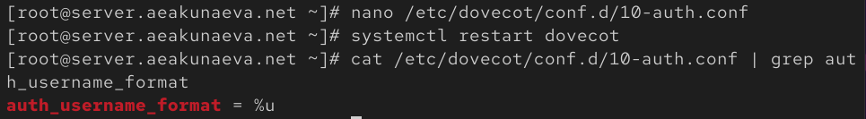{#fig:023 width=70%}

2. **Какие функции выполняет почтовый Relay-сервер?**  

Relay-сервер принимает почту и пересылает её дальше, между отправителем и конечным сервером получателя, в том числе для доменов, которые сам не обслуживает.  

3. **Какие угрозы безопасности могут возникнуть в случае настройки почтового сервера как Relay-сервера?**  

- Открытый relay: пересылка чужой почты, спам-рассылка через сервер;  

- Попадание в чёрные списки: блокировка домена и IP, недоставка легитимной почты;  

- Рост нагрузки и компроментация репутации: перегрузка сервера, риск блокировки провайдером и т.п.  


# Выводы

Я приобрела практические навыки по конфигурированию SMTP-сервера в части настройки аутентификации.

# Список литературы{.unnumbered} 

::: {#refs}
:::
