---
## Front matter
title: "Отчёт по лабораторной работе №11"
subtitle: "Настройка безопасного удалённого доступа по протоколу SSH"
author: "Акунаева Антонина Эрдниевна"

## Generic otions
lang: ru-RU
toc-title: "Содержание"

## Bibliography
bibliography: bib/cite.bib
csl: pandoc/csl/gost-r-7-0-5-2008-numeric.csl

## Pdf output format
toc: true # Table of contents
toc-depth: 2
lof: true # List of figures
lot: true # List of tables
fontsize: 12pt
linestretch: 1.5
papersize: a4
documentclass: scrreprt
## I18n polyglossia
polyglossia-lang:
  name: russian
  options:
	- spelling=modern
	- babelshorthands=true
polyglossia-otherlangs:
  name: english
## I18n babel
babel-lang: russian
babel-otherlangs: english
## Fonts
mainfont: IBM Plex Serif
romanfont: IBM Plex Serif
sansfont: IBM Plex Sans
monofont: IBM Plex Mono
mathfont: STIX Two Math
mainfontoptions: Ligatures=Common,Ligatures=TeX,Scale=0.94
romanfontoptions: Ligatures=Common,Ligatures=TeX,Scale=0.94
sansfontoptions: Ligatures=Common,Ligatures=TeX,Scale=MatchLowercase,Scale=0.94
monofontoptions: Scale=MatchLowercase,Scale=0.94,FakeStretch=0.9
mathfontoptions:
## Biblatex
biblatex: true
biblio-style: "gost-numeric"
biblatexoptions:
  - parentracker=true
  - backend=biber
  - hyperref=auto
  - language=auto
  - autolang=other*
  - citestyle=gost-numeric
## Pandoc-crossref LaTeX customization
figureTitle: "Рис."
tableTitle: "Таблица"
listingTitle: "Листинг"
lofTitle: "Список иллюстраций"
lotTitle: "Список таблиц"
lolTitle: "Листинги"
## Misc options
indent: true
header-includes:
  - \usepackage{indentfirst}
  - \usepackage{float} # keep figures where there are in the text
  - \floatplacement{figure}{H} # keep figures where there are in the text
---


# Цель работы

Приобретение практических навыков по настройке удалённого доступа к серверу с помощью SSH. [@TUIS-lab][@tanenbaum_book_modern-os_ru]

# Задание

1. Настройте запрет удалённого доступа на сервер по SSH для пользователя root (см. раздел 11.4.1).  

2. Настройте разрешение удалённого доступа к серверу по SSH только для пользователей группы vagrant и вашего пользователя (см. раздел 11.4.2).  

3. Настройте удалённый доступ к серверу по SSH через порт 2022 (см. раздел 11.4.3).  

4. Настройте удалённый доступ к серверу по SSH по ключу (см. раздел 11.4.4).  

5. Организуйте SSH-туннель с клиента на сервер, перенаправив локальное соединение с TCP-порта 80 на порт 8080 (см. раздел 11.4.5).  

6. Используя удалённое SSH-соединение, выполните с клиента несколько команд на сервере (см. раздел 11.4.6).  

7. Используя удалённое SSH-соединение, запустите с клиента графическое приложение на сервере (см. раздел 11.4.7).  

8. Напишите скрипт для Vagrant, фиксирующий действия по настройке SSH-сервера во внутреннем окружении виртуальной машины server. Соответствующим образом внесите изменения в Vagrantfile (см. раздел 11.4.8).  

# Выполнение лабораторной работы

**11.4.1. Запрет удалённого доступа по SSH для пользователя root**

На server зайдём в терминал как суперпользователь и зададим пароль для пользователя root, если этого не было сделано ранее (т.к. пароль уже был задан, укажем тот же) ([рис. @fig:001]):

```
sudo -i
passwd root
```

После сохранения изменений в файле конфигурации /etc/ssh/sshd_config (выполнено далее) перезапустим sshd:

```
systemctl restart sshd
```

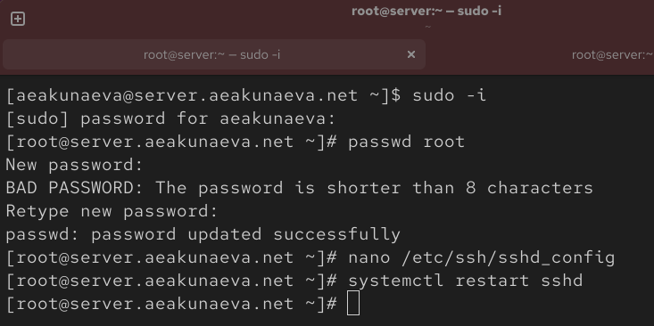{#fig:001 width=70%}

В дополнительном терминале запустим мониторинг системных событий ([рис. @fig:002])[@robbins_book_bash_en]:

```
sudo -i
journalctl -x -f
```

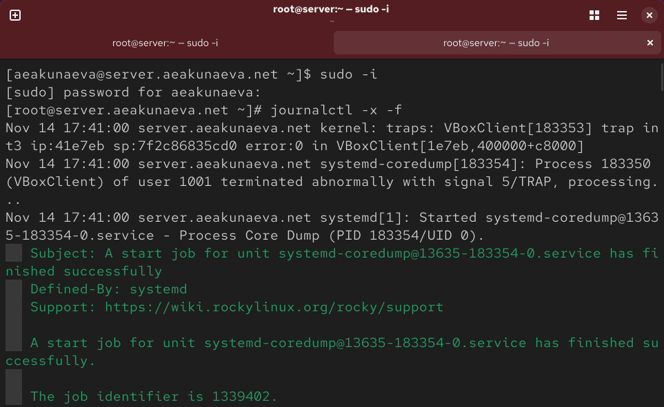{#fig:002 width=70%}

С client попытаемся получить доступ к серверу посредством SSH-соединения через пользователя root ([рис. @fig:003]):

```
ssh root@server.aeakunaeva.net
```

При попытке подключения ssh root@server.aeakunaeva.net клиент запрашивает пароль пользователя root. Подключение было заблокировано, так как в конфигурации sshd параметр PermitRootLogin no уже был установлен.

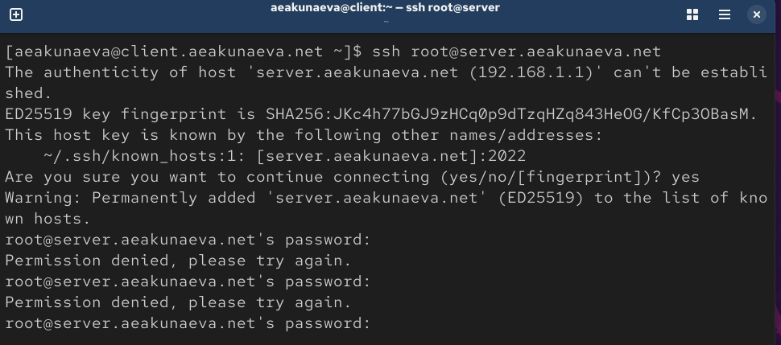{#fig:003 width=70%}

На server откроем конфигурационный файл /etc/ssh/sshd_config sshd для редактирования и запретим вход на сервер пользователю root, установив параметр ([рис. @fig:004]):

```
PermitRootLogin no
```

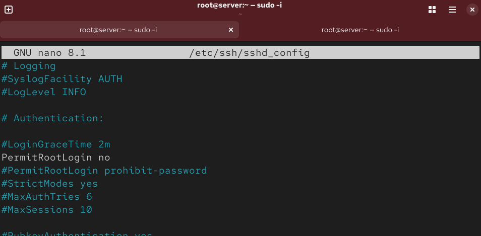{#fig:004 width=70%}

Повторим попытку получения доступа с клиента к серверу посредством SSH-соединения через пользователя root  ([рис. @fig:005])[@zarrelli_book_mastering-bash_en]:

```
ssh root@server
```

После установки PermitRootLogin no и перезапуска sshd сервер немедленно отклонит любую попытку входа под пользователем root. Клиент получает сообщение Permission denied и подклчюение не устанавливается.

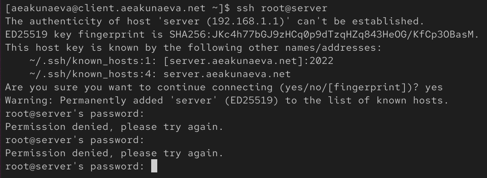{#fig:005 width=70%}

**11.4.2. Ограничение списка пользователей для удалённого доступа по SSH**

На client попытаемся получить доступ к серверу посредством SSH-соединения через пользователя aeakunaeva ([рис. @fig:006])[@newham_book_learning-bash_en]:

```
ssh aeakunaeva@server.aeakunaeva.net
```

После ввода пароля мы успешно подключаемся к удалённому серверу и отображается время последнего успешного захода.

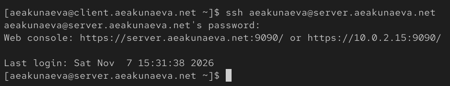{#fig:006 width=70%}

В конфигурационном файле /etc/ssh/sshd_config на server добавим строку ([рис. @fig:007]):

```
AllowUsers vagrant
```

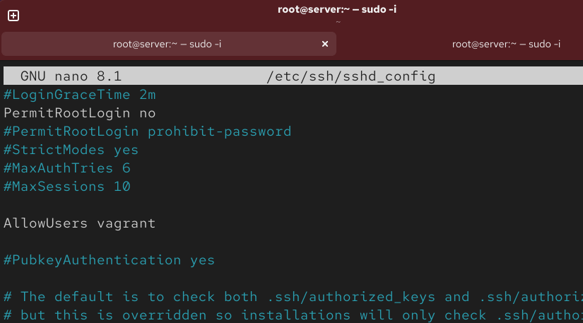{#fig:007 width=70%}

После сохранения изменений в конфигурационном файле (и всех последующих попытках) перезапускаем sshd ([рис. @fig:008]):

```
systemctl restart sshd
```

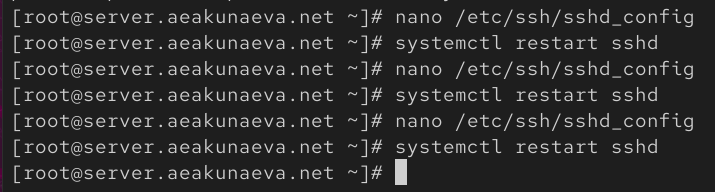{#fig:008 width=70%}

Повторим попытку аодключения после внесённых на сервере изменений на client к нему посредством SSH-соединения через пользователя aeakunaeva ([рис. @fig:009]):

```
ssh aeakunaeva@server.aeakunaeva.net
```

У нас (необязательно) спросят, точно ли мы хотим подключиться, но даже при положительном ответе будет отказано в доступе после ввода пароля.

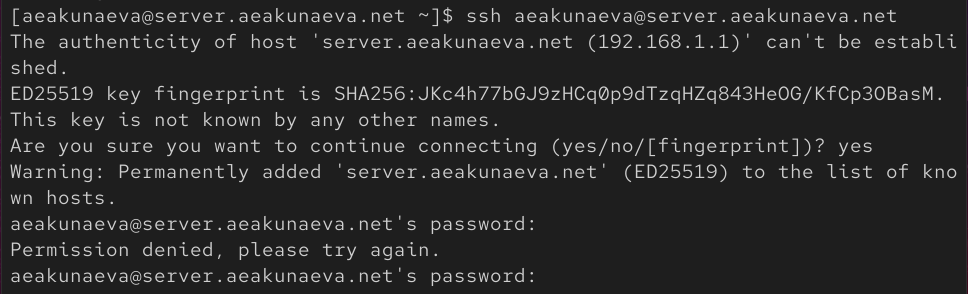{#fig:009 width=70%}

В конфигурационном файле /etc/ssh/sshd_config на server добавим в строке AllowUsers наш логин ([рис. @fig:010]):

```
AllowUsers vagrant aeakunaeva
```

Затем перезапустим sshd.

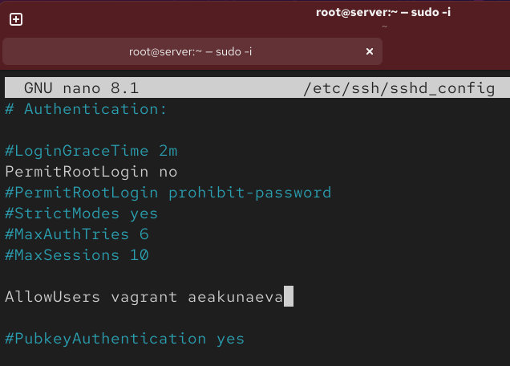{#fig:010 width=70%}

На client снова попробуем подключиться к серверу и на этот раз подключение будет успешным, т.к. мы добавили клиента в список допускаемы хпользователей к подключению. Отобразится время последнего успешного захода и безуспешного, а также количество неудачных попыток подключиться ([рис. @fig:011]):

```
ssh aeakunaeva@server.aeakunaeva.net
```

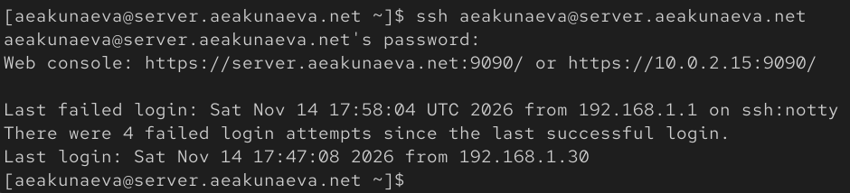{#fig:011 width=70%}

**11.4.3. Настройка дополнительных портов для удалённого доступа по SSH**

В конфигурационном файле /etc/ssh/sshd_config на server найдём строку Port и ниже неё добавим ([рис. @fig:012]):

```
Port 22
Port 2022
```

Затем снова перезапустим sshd.

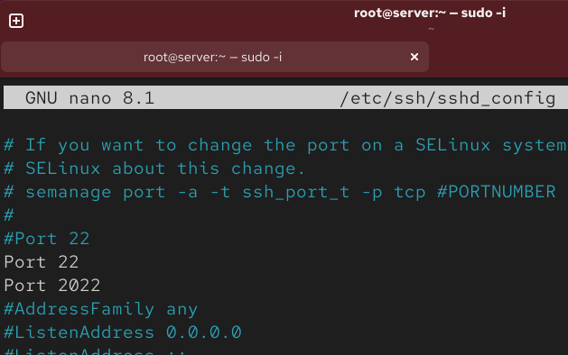{#fig:012 width=70%}

Просмотрим расширенный статус работы sshd ([рис. @fig:013]-[рис. @fig:014]):

```
systemctl status -l sshd
```

Ошибками будет показан отказ системы в работе sshd через порт 2022. Во втором терминале в журнале мониторинга служебных сообщений в выводе появится ошибка bind to port 2022 failed: Permission denied. Суть сообщения в том, что SELinux не разрешает процессу sshd использовать нестандартный порт 2022, так как контекст ssh_port_t по умолчанию привязан только к порту 22.

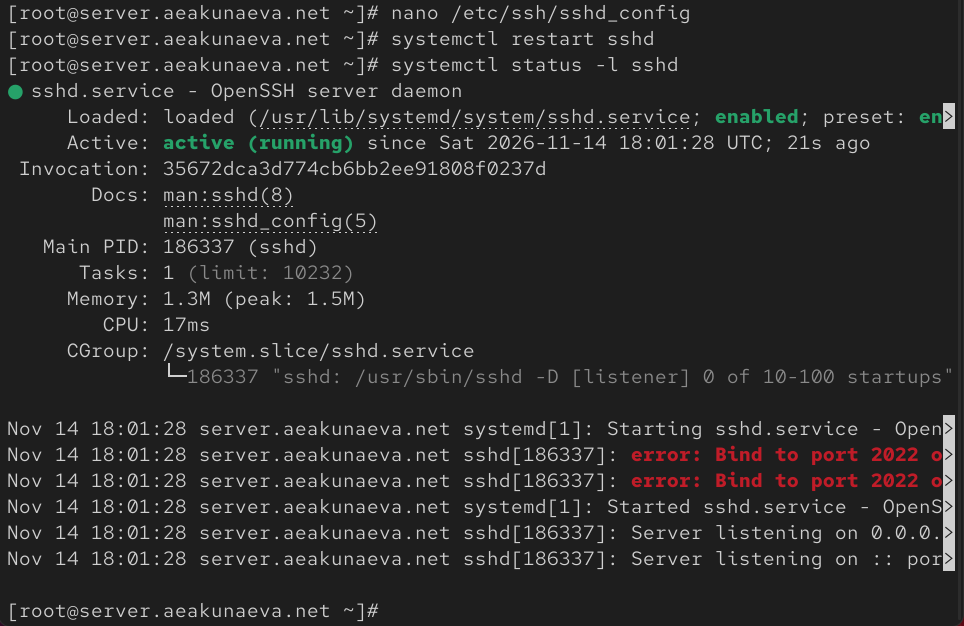{#fig:013 width=70%}

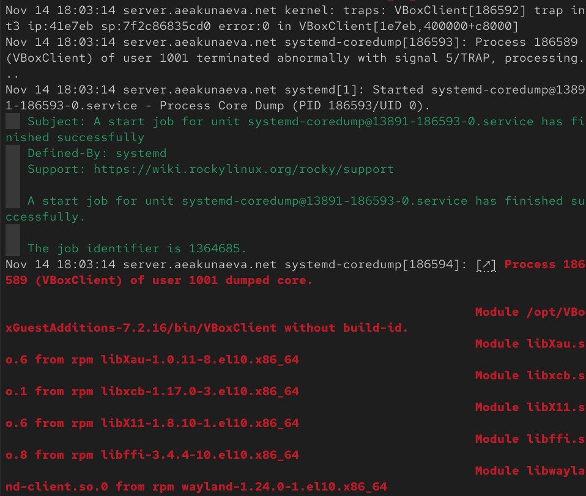{#fig:014 width=70%}

Исправим на server метки SELinux к порту 2022 и в настройках межсетевого экрана откроем порт 2022 протокола TCP ([рис. @fig:015]):

```
semanage port -a -t ssh_port_t -p tcp 2022

firewall-cmd --add-port=2022/tcp
firewall-cmd --add-port=2022/tcp --permanent
```

Затем вновь перезапустим sshd и посмотрим расширенный статус его работы. Статус показывает, что процесс sshd теперь прослушивает два порта и ошибок не отображается:

```
systemctl restart sshd
systemctl status -l sshd
```

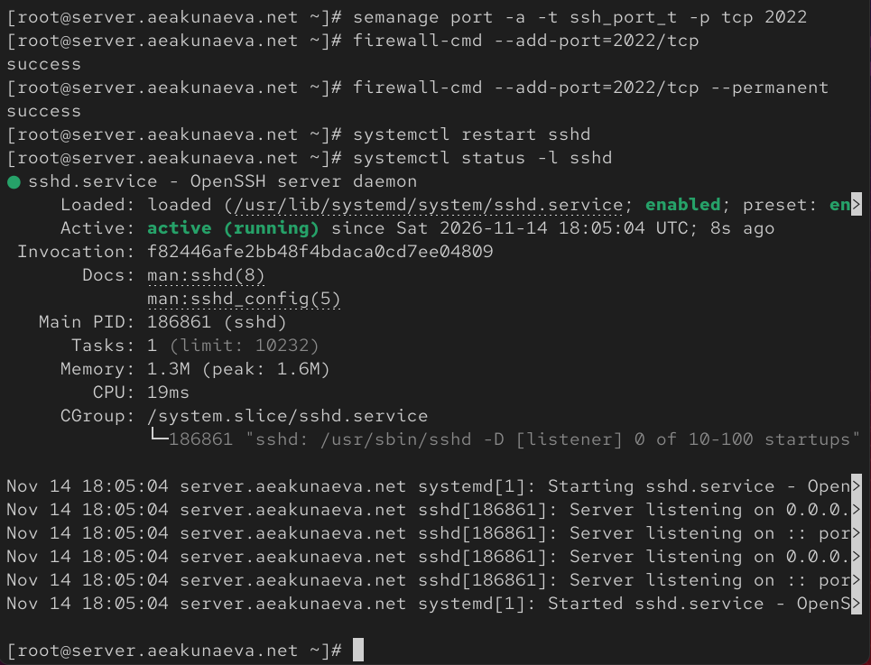{#fig:015 width=70%}

С client попытаемся получить доступ к серверу ([рис. @fig:016]):
 
```
ssh aeakunaeva@server.aeakunaeva.net
```

Успешнр подключимя и в оболочке получим доступ пользователя root и введём пароль:

```
sudo -i
```

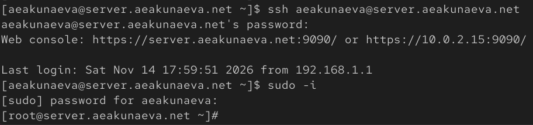{#fig:016 width=70%}

Повторим попытку подклчюения, но уже через порт 2022 ([рис. @fig:017]):
 
```
ssh -p2022 aeakunaeva@server.aeakunaeva.net
```

Также получим права root:

```
sudo -i
```

После успешного подключения отлогинемся от root и пользователя на сервере комбинацией Ctrl+D дважды.

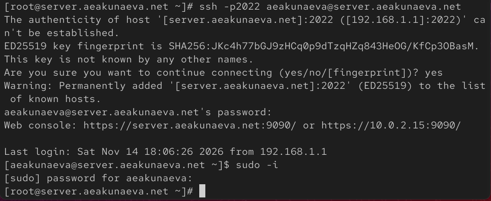{#fig:017 width=70%}

**11.4.4. Настройка удалённого доступа по SSH по ключу**

В конфигурационном файле /etc/ssh/sshd_config на server зададим параметр, разрешающий аутентификацию по ключу ([рис. @fig:018]):

```
PubkeyAuthentication yes
```

Затем перезапустим sshd.

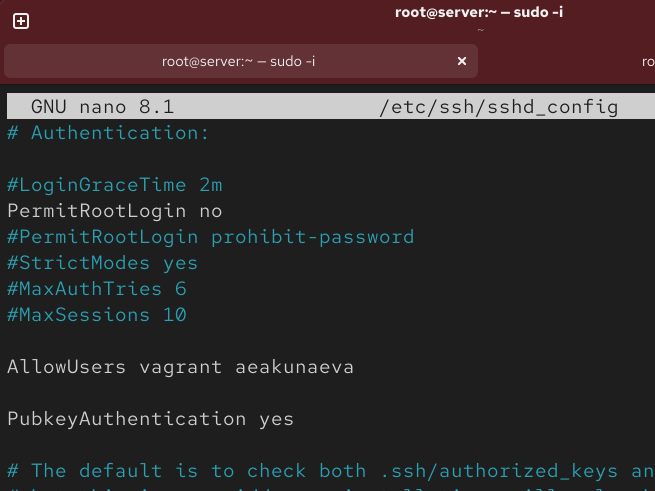{#fig:018 width=70%}

На client сформируем SSH-ключ в терминале под пользователем aeakunaeva, приняв все настройки по умолчанию ([рис. @fig:019]):

```
ssh-keygen
```

Скопируем открытый ключ на сервер, введя пароль:

```
ssh-copy-id aeakunaeva@server.aeakunaeva.net
```

Затем попробуем получить доступ с клиента к серверу снова:

```
ssh aeakunaeva@server.aeakunaeva.net
```

Мы получим доступ без аутентификации через ввод пароля. После отлогинемся от сервера через Ctrl+D.

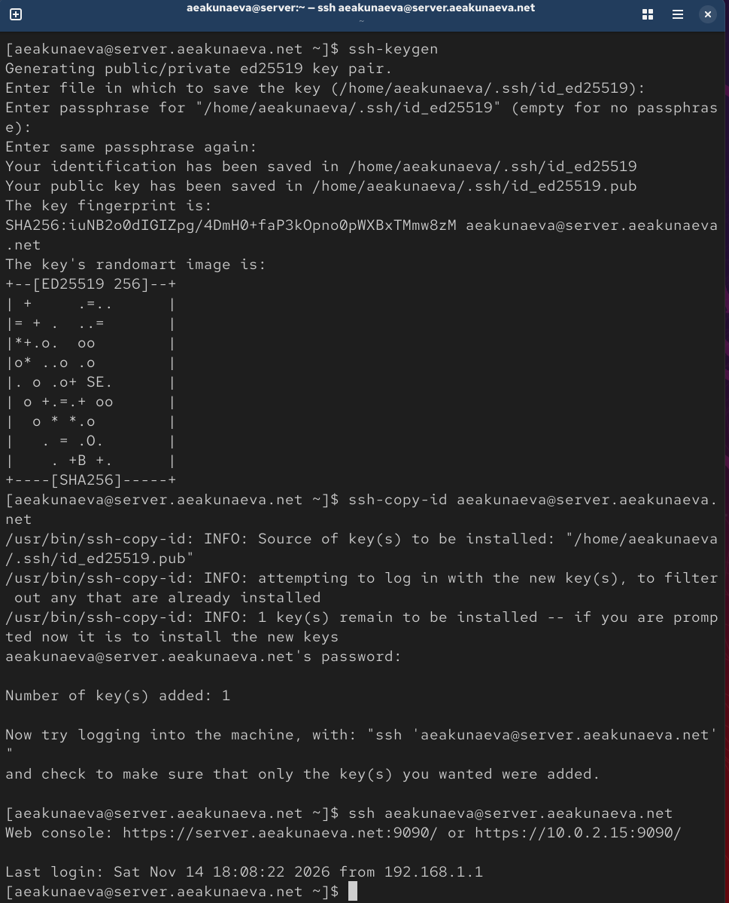{#fig:019 width=70%}

**11.4.5. Организация туннелей SSH, перенаправление TCP-портов**

На client посмотрим, запущены ли какие-либо службы с протоколом TCP ([рис. @fig:020]):

```
lsof | grep TCP
```

Увидем несколько запущенных служб. Тогда перенаправим порт 80 на server.aeakunaeva.net на порт 8080 на локальной машине:

```
ssh -fNL 8080:localhost:80 aeakunaeva@server.aeakunaeva.net
```

И снова просмотрим список запущенных служб с протоколом TCP. Появятся новая прослушиваемая служба ssh.

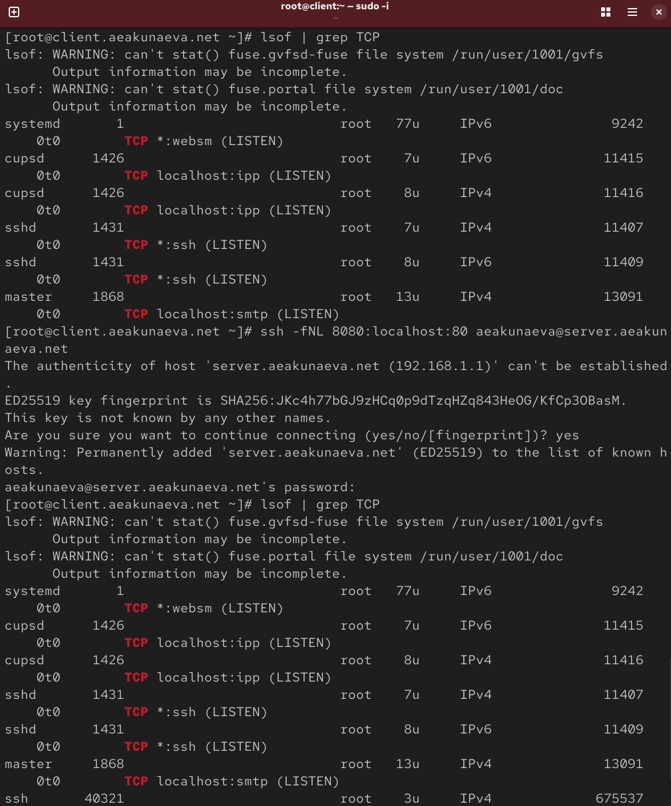{#fig:020 width=70%}

На client запустим браузер Firefox и перейдём по адресу localhost:8080. ОТобразится страница с надписью Welcome to the server.aeakunaeva.net server» ([рис. @fig:021]):

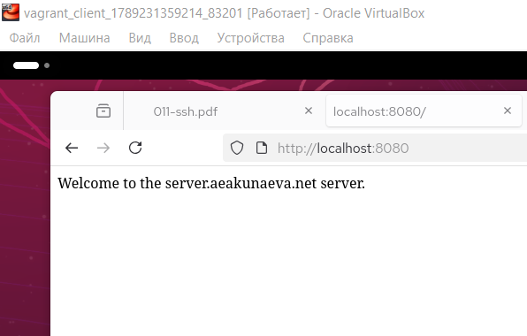{#fig:021 width=70%}

**11.4.6. Запуск консольных приложений через SSH**

На client посмотрим имя узла сервера, список файлов на сервере и почту ([рис. @fig:022]-[рис. @fig:023]):

```
ssh aeakunaeva@server.aeakunaeva.net hostname
ssh aeakunaeva@server.aeakunaeva.net ls -Al
ssh aeakunaeva@server.aeakunaeva.net MAIL=~/Maildir/ mail
```

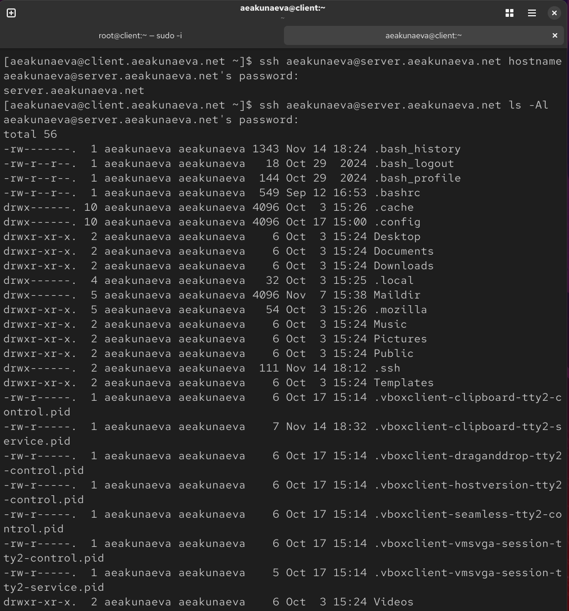{#fig:022 width=70%}

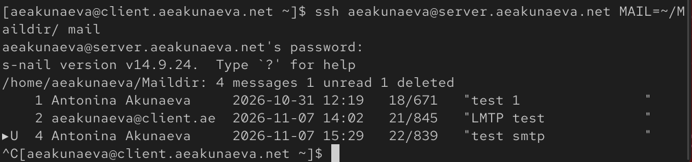{#fig:023 width=70%}

**11.4.7. Запуск графических приложений через SSH (X11Forwarding)**

В конфигурационном файле /etc/ssh/sshd_config на server разрешим отображать на локальном клиентском компьютере графические интерфейсы X11 ([рис. @fig:024]):

```
X11Forwarding yes
```

После сохранения изменения в конфигурационном файле перезапустим sshd.

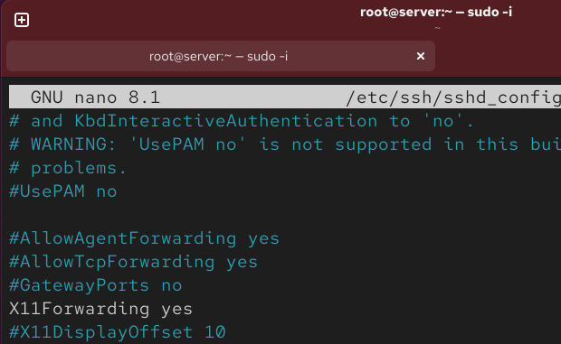{#fig:024 width=70%}

Попробуем с client удалённо подключиться к серверу и запустить графическое приложение, например firefox ([рис. @fig:025]):

```
ssh -YC aeakunaeva@server.aeakunaeva.net firefox 
```

Откроется браузер Firefox.

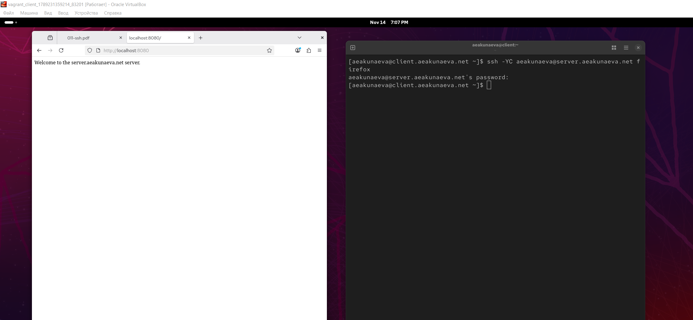{#fig:025 width=70%}

**11.4.8. Внесение изменений в настройки внутреннего окружения виртуальной машины**

На server перейдём в каталог для внесения изменений в настройки внутреннего окружения /vagrant/provision/server/, создадим в нём каталог ssh, в который поместим в соответствующие подкаталоги конфигурационный файл sshd_config, в каталоге /vagrant/provision/server создадим исполняемый файл ssh.sh ([рис. @fig:026]):

```
cd /vagrant/provision/server
mkdir -p /vagrant/provision/server/ssh/etc/ssh
cp -R /etc/ssh/sshd_config /vagrant/provision/server/ssh/etc/ssh/
cd /vagrant/provision/server
touch ssh.sh
chmod +x ssh.sh
```

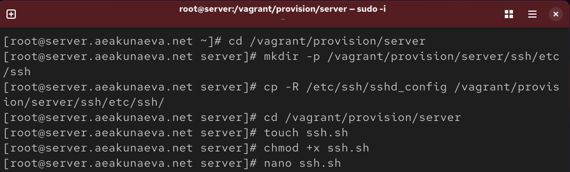{#fig:026 width=70%}

Откроем конфигурационный файл /vagrant/provision/server/ssh.sh и добавим в него скрипт ([рис. @fig:027]):

```
#!/bin/bash
echo "Provisioning script $0"
echo "Copy configuration files"
cp -R /vagrant/provision/server/ssh/etc/* /etc
restorecon -vR /etc
echo "Configure firewall"
firewall-cmd --add-port=2022/tcp
firewall-cmd --add-port=2022/tcp --permanent
echo "Tuning SELinux"
semanage port -a -t ssh_port_t -p tcp 2022
echo "Restart sshd service"
systemctl restart sshd
```

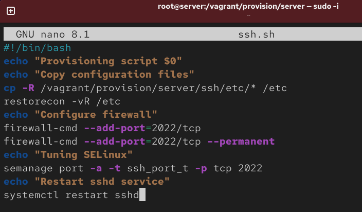{#fig:027 width=70%}

Чтобы скрипт отработал при запуске vagrant, добавим в Vagrantfile ([рис. @fig:028]):
 
```
server.vm.provision "server ssh",
type: "shell",
preserve_order: true,
path: "provision/server/ssh.sh"
```

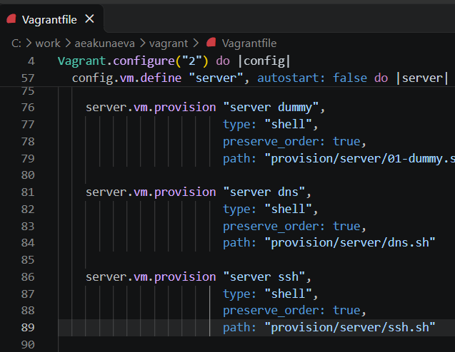{#fig:028 width=70%}


# Контрольные вопросы

1. **Вы хотите запретить удалённый доступ по SSH на сервер пользователю root и разрешить доступ пользователю alice. Как это сделать?**  

Чтобы запретить доступ root и разрешить доступ пользователю alice, нужно открыть файл /etc/ssh/sshd_config и установить две директивы: PermitRootLogin no и AllowUsers alice. После сохранения файла выполнить systemctl restart sshd.  

2. **Как настроить удалённый доступ по SSH через несколько портов? Для чего это может потребоваться?**  

Чтобы настроить доступ через несколько портов, в файле /etc/ssh/sshd_config нужно указать несколько строк Port, например Port 22 и Port 2022. Это может потребоваться для резервирования (если основной порт заблокирован провайдером или файрволом), для обхода автоматических сканеров и брутфорс-атак, а также для разделения трафика между разными группами пользователей.  

3. **Какие параметры используются для создания туннеля SSH, когда команда ssh устанавливает фоновое соединение и не ожидает какой-либо конкретной команды?**  

Для создания фонового туннеля без выполнения удалённой команды используются параметры -f и -N. Параметр -f переводит ssh в фоновый режим после аутентификации, а параметр -N указывает не выполнять удалённую команду (используется только для переадресации портов).  

4. **Как настроить локальную переадресацию с локального порта 5555 на порт 80 сервера server2.example.com?**  

Чтобы настроить локальную переадресацию с порта 5555 на порт 80 сервера server2.example.com, нужно выполнить команду ssh -L 5555:server2.example.com:80 aeakunaeva@промежуточный_сервер. Если подключение идёт напрямую к нужному серверу, команда будет выглядеть как ssh -L 5555:localhost:80 aeakunaeva@server2.example.com.  

5. **Как настроить SELinux, чтобы позволить SSH связываться с портом 2022?**  

Чтобы разрешить SSH связываться с портом 2022 в SELinux, нужно выполнить команду:

```
semanage port -a -t ssh_port_t -p tcp 2022
```

Она добавит порт 2022 в список разрешённых для контекста ssh_port_t.  

6. **Как настроить межсетевой экран на сервере, чтобы разрешить входящие подключения по SSH через порт 2022?**  

Чтобы разрешить входящие подключения по SSH через порт 2022 в межсетевом экране, нужно выполнить:

```
firewall-cmd --add-port=2022/tcp
firewall-cmd --add-port=2022/tcp --permanent
```


# Выводы

Я приобрела практические навыки по настройке удалённого доступа к серверу с помощью SSH.

# Список литературы{.unnumbered} 

::: {#refs}
:::
